# rpggen user guide

This guide takes you from installation to a project you can play. The pictures are produced by
`tools/make_doc_screenshots.py` from the bundled sample pack, so they match the program.

## 1. Install

See the [README](../README.md#install). You need rpggen, **Godot 4.7.2** (standard build) and,
optionally, the Godot **export templates for 4.7.2** (used by the export check). rpggen finds Godot
in the usual places; you can also pick the executable on the first page. Choose the file that ends
in `_console.exe` if you have it.

## 2. First run with the sample pack

1. Start rpggen. It opens on the **welcome view**: *Try the sample*, *Start with my asset pack*
   and *Open an existing project*, the projects you opened lately, and the Godot rpggen found
   (or a **Download Godot 4.7.2** button when there is none, see
   [Privacy and the network](#8-privacy-and-the-network)).
2. Press **Try the sample**. rpggen fills in the bundled sample pack, a project name and an
   output folder in *Documents*, checks them, reads the pack and takes you to the last settings
   page.
3. Press **Generate**. The page lists the phases (preflight, stage, install, catalog, import,
   build, validate, smoke, export, promote, report) with a log underneath. It takes about a minute.
4. On **Results** press **Open in Godot** and then F5. You start on the title screen, begin a new
   game, walk around, talk to the villager, open the chest and enter the house.

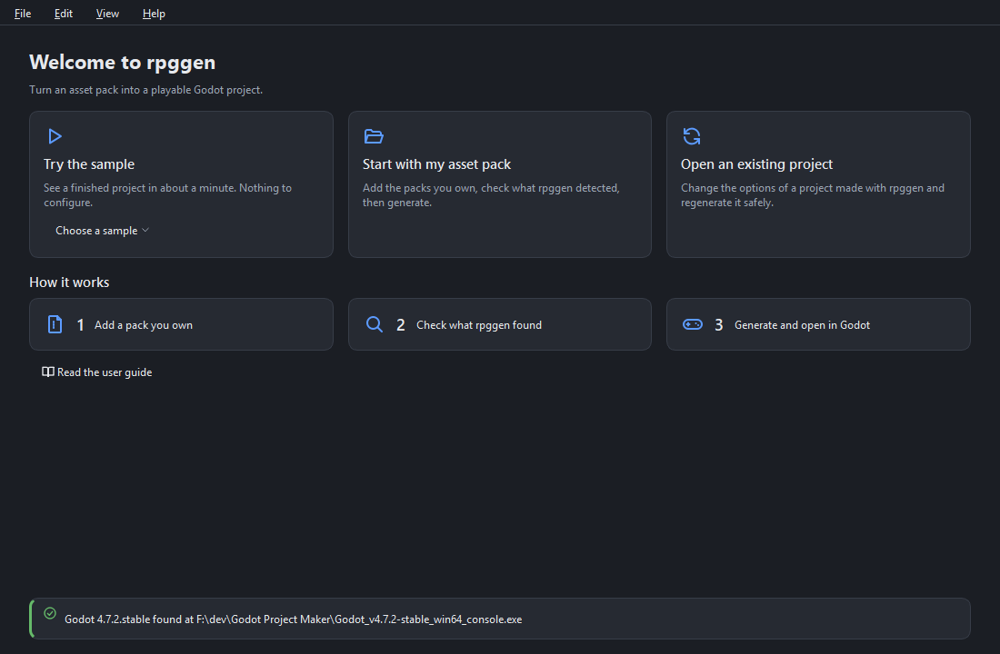

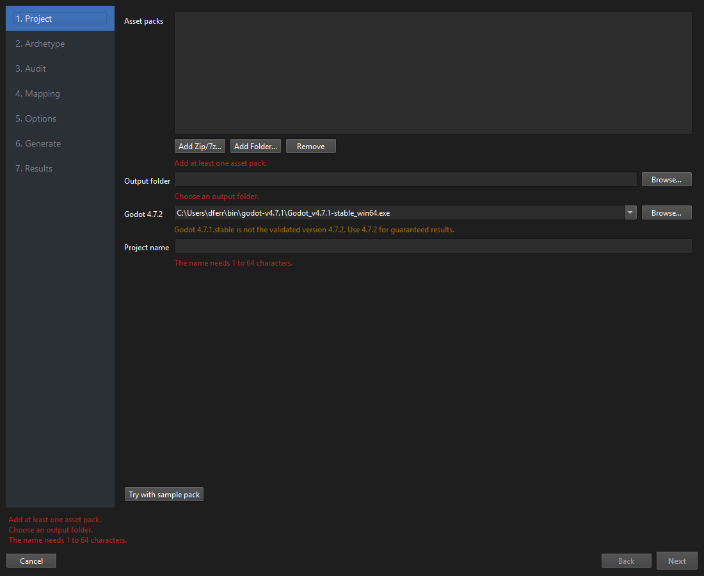

The **Help** menu has the user guide (F1 opens it at the page you are on), the list of error
codes with their fixes, the keyboard shortcuts, *Report a problem…*, *Check for updates…* and
*About rpggen* (version, licenses and the third-party notices). The **View** menu switches
between the dark and the light theme and sets the size of the thumbnails; **File** lists your
recent projects.

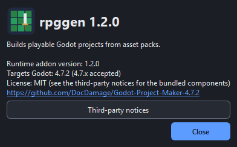

## 3. Using a pack you bought

**Project page.** Add one or more packs (drag a folder or archive onto the list, or use *Add Zip/7z…* or *Add Folder…*).
Packs stay untouched: rpggen copies what it needs into the project. Pick an **output folder**
that is empty (or an existing rpggen project, see [regeneration](regeneration.md)), the **Godot
executable** and a **project name**. Red text under a field says what is wrong; the **Next** button
stays disabled until everything is green. Avoid cloud-sync folders (OneDrive, Dropbox): they can
lock files during generation (ENV-006).

Rarely, a pack has a password or contains something unsafe (ARCH-002, ARCH-003, ARCH-004); extract
it yourself and add the folder.

**Archetype page.** Choose how combat works:

* **Turn-based**: encounters on the map start a battle screen with attack, defend, item and run.
  Up to four characters can fight together (the demo villager can bring a companion along).
* **Action RPG**: real-time sword swings with hitboxes, enemies that chase and attack, a HUD.
  It has no party members or followers in 1.0.

You can generate the other archetype later in a new project; the shared systems (saving,
dialogue, inventory, equipment, menus) are the same.

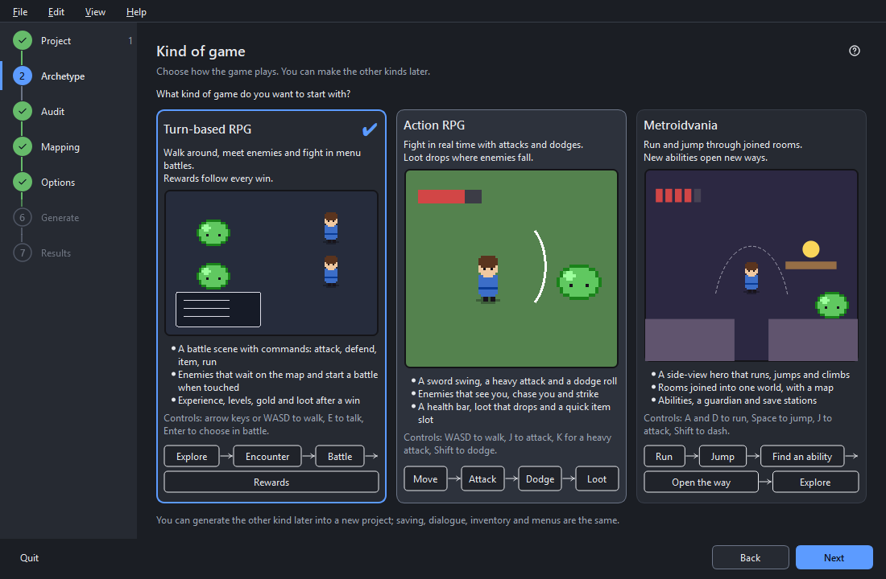

**Audit page.** rpggen has guessed what every file is. This is where you check the guesses.

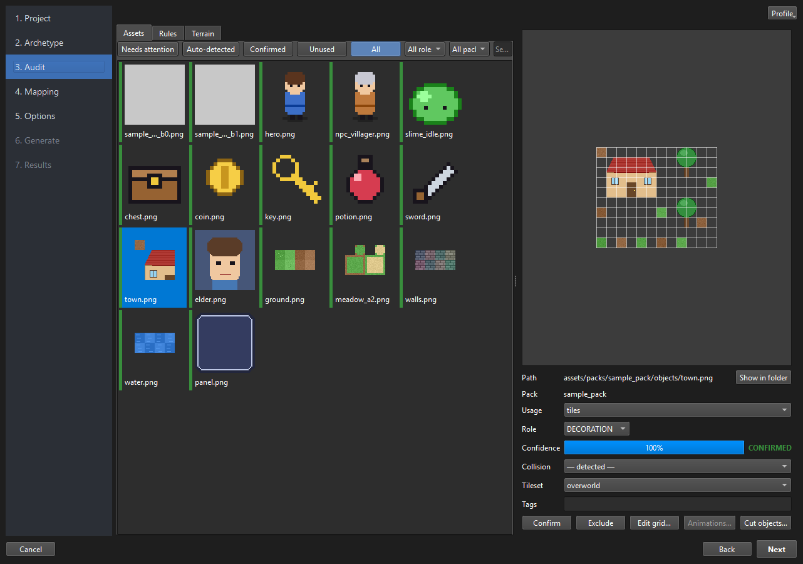

* The grid shows thumbnails with a coloured edge and a small glyph in the corner, so the state
  can be told without colour: ✔ green = confirmed, blue = auto-detected, ? orange = needs
  review, ! red = conflict, ∅ purple = missing from the pack, grey = unused. The chips above
  filter by status; it opens on **Needs attention**. Filters also exist for role, pack and a
  path search. Audio files show a plain square.
* **The queue.** After the first look the page works through what needs attention: `N` and
  `Shift+N` jump to the next and the previous asset that does, and a line under the grid says how
  many are left and when the queue is empty.
* Select an asset to see its details on the right: usage (tiles, sprite, icon, ...), role (what
  the generator uses it for, e.g. GROUND, WALL, PLAYER, ENEMY), tile grid, collision, tile set,
  tags. Change a value and the thumbnail updates; **Confirm** marks an asset as checked,
  **Exclude** leaves it out. Everything is undoable (Ctrl+Z, Ctrl+Y).
* **Keys:** `C` confirm, `X` exclude, `N` / `Shift+N` next / previous asset that needs
  attention, `1`-`9` quick roles, `Ctrl` + mouse wheel zooms the grid (or use *View → Thumbnail
  size*). *Help → Keyboard shortcuts* lists them all; `Alt+N` and `Alt+B` are Next and Back.
* **Bulk actions:** select many assets (Ctrl/Shift-click) and use the panel at the bottom: every
  combo reads "— unchanged —" until you pick something.
* **Rules:** right-click an asset → *Make rule for this folder…* so that everything in a folder
  (a glob such as `characters/**`) gets the same role or tags, now and after pack updates. The
  *Rules* tab lists them; drag to reorder.
* **Grid editor** (*Edit grid…*): cell size, margin and separation with a live readout
  (`12 × 4, 47 non-empty, remainder 0 px`) and the five best candidates. ASSET-003 appears here
  when the sheet does not divide evenly.
* **Animations** (*Animations…*): a direction-grouped list of animations with playback, click the
  sheet to pick frames, mirror left from right, reverse, ping-pong, origin and baseline, and
  *active frames* (the hit frames) for the action RPG.
* **Object cutter** (*Cut objects…*): draw rectangles around a house or tree in a sheet, set its
  footprint (where it blocks), door and origin. Detected objects appear blue, yours green.
* **Terrain tab:** autotile proposals for RPG Maker A2 sheets and 47-tile blob sheets.
* **Profile menu:** export your audit as a profile, import one, or find one online
  ([profiles](profiles.md)).

**Mapping page.** A checklist of what the starter map and the systems need: ground, wall, player,
NPC, enemy, chest, building, UI and so on. Each row shows the chosen asset. *Choose…* lists only
assets that could plausibly fill the role; *Clear* goes back to the automatic choice. If a
required role has no asset you can continue with a **placeholder** (a labelled debug picture,
ASSET-010) and fix it later.

**Sound.** Under the roles, the *Sound* section lists **sound slots**: the map, battle and title
music, the menu cursor, confirm and cancel sounds, and the sounds of a hit, an attack, a
pick-up, a chest, a door, a footstep, saving and a level-up. rpggen fills each slot from the
audio of your packs by file name; *Edit…* shows a row per slot with **Choose…** (a list of the
audio files, with ▶ to listen and the length of each), **▶** and **Clear**. A cleared slot is
silent. A pack without audio simply gives a silent game.

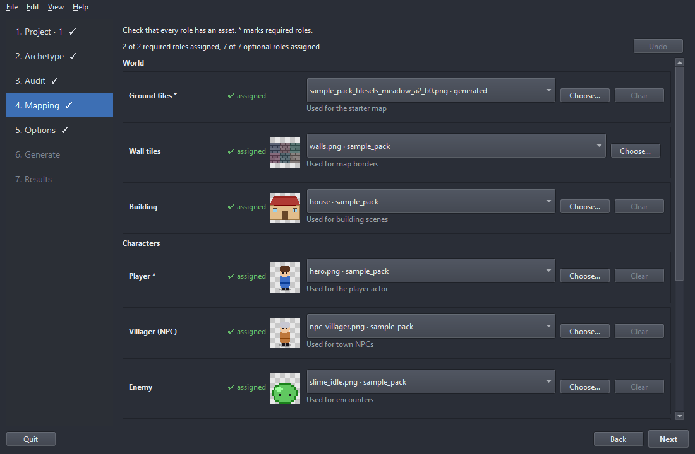

**Options page.** Features (dialogue, combat, saving, demo content, editor tools, debug tools),
resolution and window mode, the **layers** of the map (Ground is always there; add Decoration,
Collision, anything), and under *Advanced* the random seed, key/gamepad bindings and the option to
**initialize a git repository** and commit.

* **Presets.** *Save as preset…* keeps the options for your next project; *Manage…* renames or
  deletes them. A preset only fills the options, never the packs or the folder, and *Defaults*
  returns to the factory values.
* **Starter map.** The *Starter map* box sets the size in tiles (24 to 96, with the names Small,
  Medium and Large), the ground set, how many buildings, villagers, enemies, chests,
  decorations and ground patches. The picture beside it is the real plan, drawn from your assets:
  *Reroll* picks a new seed (under *Advanced*). With the default settings the map is the one earlier versions made. A project that
  already has a starter map keeps it; the box then says so and the preview is switched off.

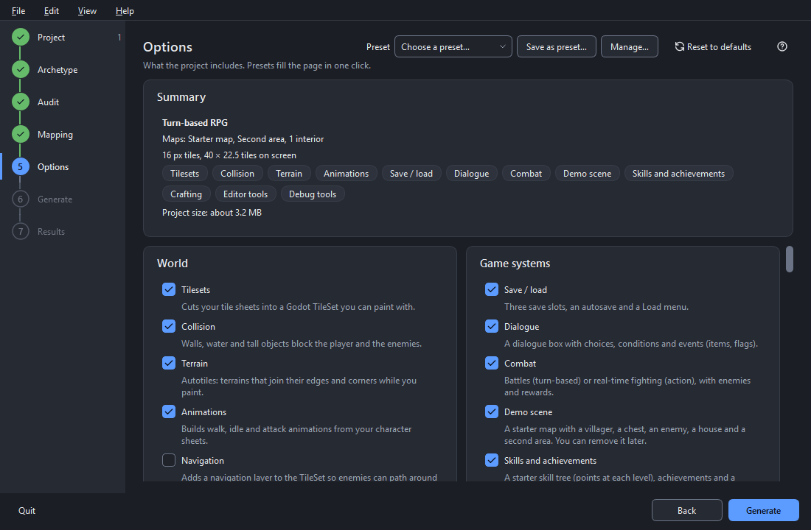

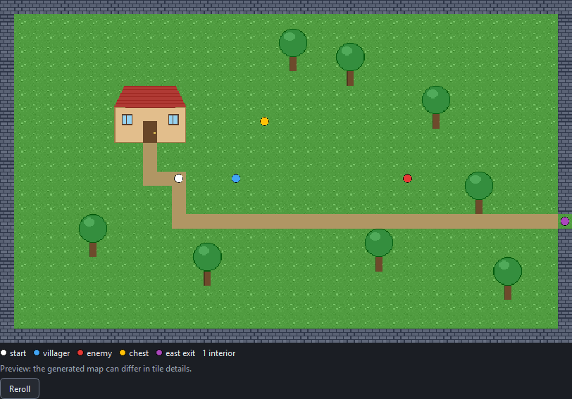

**Generate and Results.** Generation runs on a copy (`.rpggen_staging`) and only a validated,
smoke-tested result replaces your folder, so a failure never leaves a half project behind.

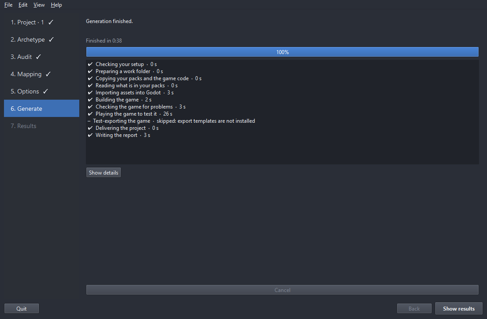

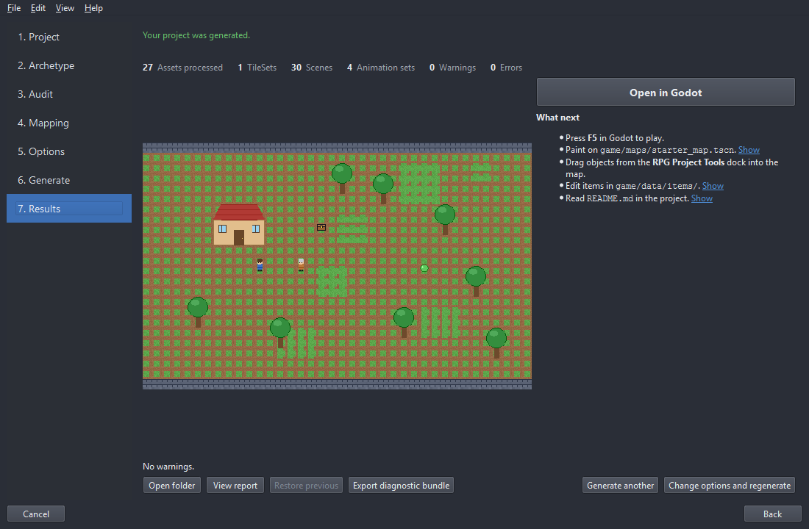

* The page leads with a picture of the starter map that was generated (click it to open the
  file) and a *What next* list: press F5, paint on the map, drag objects from the dock, edit the
  items, read the project's `README.md`. While it runs the page shows each phase with its time,
  and a notification tells you when it is done if the window is in the background.
* **Open in Godot / Open folder / View report** (`GENERATION_REPORT.md` explains what was
  generated, what to review and the packs' licenses).
* **Restore previous** undoes the last regeneration.
* On failure: the failing phase, the problems with a fix text, **Open failed folder**, **View
  logs** and **Export diagnostic bundle**.

## 4. In Godot

The project has a `README.md` with the controls and where things are: the sound slots and how to
change them, the heavy attack of the action game, autosave and the game-over screen, and how the
three maps (starter map, house, field) are connected. Your own work goes in
`game/`; rpggen never overwrites it. The **RPG Project Tools** dock lists every object, building and
character from your packs: drag one into the map (it lands on the right layer, snapped, Y-sorted),
edit an asset's role or collision in the inspector and *Rebuild*, validate the content (duplicate
entity ids, broken doors, missing sprites) and remove the demo content when you start your game.

## 5. Regenerating

Change options, fix the audit, or add a new release of a pack, then run rpggen on the same output
folder. Your maps, scenes and everything under `game/` are kept. Read [regeneration](regeneration.md).

## 6. Troubleshooting

Every message has a code; [errors.md](errors.md) lists all of them with the fix. The common ones:

| Code | Meaning | What to do |
|------|---------|------------|
| ENV-001 / ENV-002 | Godot not found or not 4.7.x | Select the Godot 4.7.2 executable on the project page. |
| ENV-003 | A different 4.7.x build than the validated 4.7.2 | Works, but use 4.7.2 for guaranteed results. |
| ENV-005 | Not enough disk space | Free space or pick another drive (3× the pack size is needed). |
| ENV-006 | Output in a cloud-sync folder | Pick a local folder. |
| ENV-007 | Paths may exceed 260 characters | Use a shorter output folder or enable Windows long paths. |
| ENV-009 | The output folder is not empty | Pick an empty folder or an existing rpggen project. |
| ENV-010 | Export templates missing | Info only: install them from Godot (Editor → Manage Export Templates) to enable the export check. |
| ASSET-010 | A required role has no asset | Assign one on the Mapping page or use a placeholder. |
| ASSET-001 / ASSET-003 | Tile size uncertain / grid does not divide | Fix the grid in the audit. |
| REGEN-005 | The Godot editor has the project open | Close it, press Retry. |
| REGEN-006 | A new major runtime version | Confirm the upgrade (`--accept-runtime-upgrade` on the CLI). |
| BUILD-00x / VAL-0xx / SMOKE-00x | A recipe, validation or smoke step failed | View the logs, export a diagnostic bundle. |
| GUI-001 | An unexpected error in rpggen | Export a diagnostic bundle and report it. |

The **Help → Error codes…** dialog looks a code up and shows what to do. Light theme:

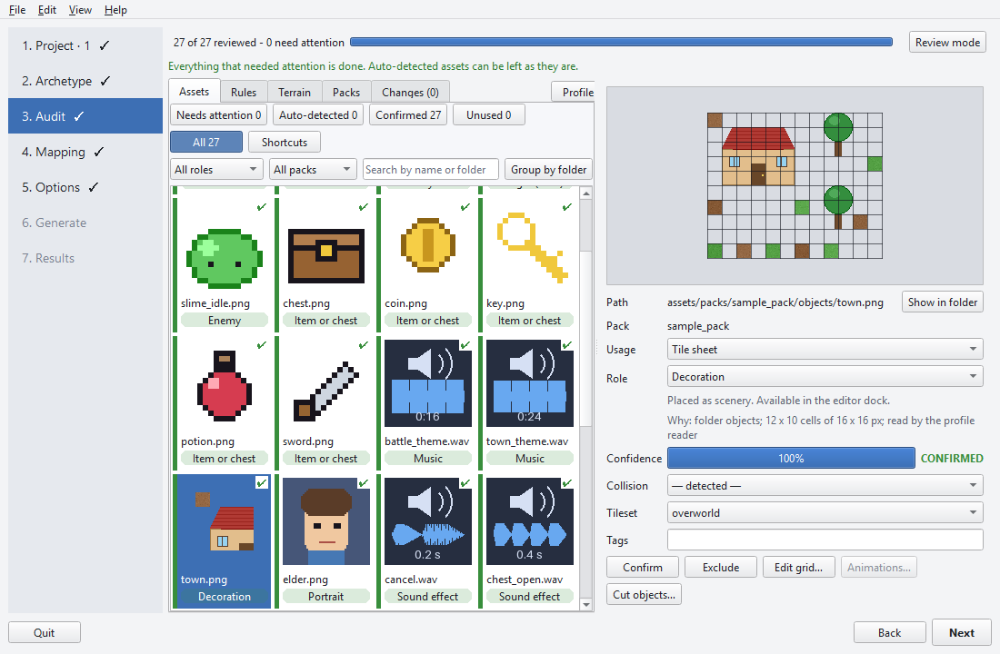

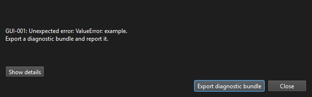

## 7. Diagnostic bundles

If something goes wrong that you cannot fix, send a diagnostic bundle with your bug report:

* In the wizard: **Export diagnostic bundle** on the Results page or in the error dialog.
* On the command line: `rpggen-cli diagnose --target <project or .rpggen_failed folder>`.

The zip has your configuration and catalog, the ownership ledger, build results, the logs (with
your user name and home folder replaced by `<user>` and `<home>`, each cut to its last 5 MB), a
manifest of every asset (id, path, hash, size) and system information. **It never contains images
or audio.** Open it before you send it if you like.

## 7a. Running rpggen from a script

Everything the wizard does for a finished config is also a command (`rpggen-cli`, see the README).
Four options are meant for scripts and build servers:

* `--dry-run` (on `generate`) checks the packs, the output folder and the requirements and plans
  the starter map without writing anything or starting Godot. Use it to find out, before a long
  run, that a role has no asset or that the folder belongs to something else.
* `--confirm` (on `generate`) prints what a regeneration is about to change (files to update,
  your changed files that get a `.rpggen-new` copy, deletions) and asks y/N on a terminal. Without
  a terminal the answer is no and the run is cancelled (exit code 4). In the wizard the same list
  is shown in a dialog before a regeneration writes anything (Edit > Show changes before
  regenerating, on by default).
* `--json` prints one JSON document on stdout; the readable lines go to stderr.
* The **exit code** says why a command stopped: 0 OK, 1 generation failed, 2 usage error,
  3 environment or input (Godot or a pack not found, an unusable folder, a required role with no
  asset), 4 cancelled with Ctrl+C (nothing is delivered), 70 internal error (send a diagnostic
  bundle).

## 8. Privacy and the network

rpggen does not phone home. It goes online in exactly three cases, and only after you click:

1. **Find profile online** (Audit page, Profile menu): downloads the community profile index
   and the profile you pick from this project's `registry/` folder on GitHub.
2. **Download Godot** (Project page, or the welcome view): downloads the official Godot 4.7.2
   from github.com/godotengine/godot/releases after you confirm the source, size and
   destination, verifies its SHA-512 checksum and keeps it in rpggen's own folder. Your other
   Godot versions are not touched.
3. **Help > Check for updates**: asks GitHub for the latest release of this project and offers
   to open its download page in your browser. rpggen never downloads or installs an update.

There is no start-up check, no background timer and no setting that enables one.

## 9. Where rpggen keeps its files

rpggen keeps what it needs in three folders, so that a disk-cleanup tool (which empties folders
called "cache") cannot take your work with it. **Edit → Storage…** shows how big each part is and
clears it.

| Folder | What is in it | Windows | Linux | macOS |
|--------|---------------|---------|-------|-------|
| Settings | `settings.json`: window, theme, recent projects, option presets | `%LOCALAPPDATA%\rpggen\config` | `~/.config/rpggen` | `~/Library/Application Support/rpggen` |
| Your data | drafts of audits you have not generated yet, installed pack profiles, the Godot rpggen downloaded, the logs | `%LOCALAPPDATA%\rpggen\data` | `~/.local/share/rpggen` | `~/Library/Application Support/rpggen` |
| Cache | extracted archives, analysis results, file lists, thumbnails, GIF strips, terrain sheets | `%LOCALAPPDATA%\rpggen\cache` | `~/.cache/rpggen` | `~/Library/Caches/rpggen` |

(On Linux the `XDG_CONFIG_HOME`, `XDG_DATA_HOME` and `XDG_CACHE_HOME` variables are honoured.)

* **The cache can always be made again**, so it is kept small: extracted packs beyond the limit
  in **Storage…** (10 GB by default) are removed, the least recently used first and never the one
  you are working with; analysis results, file lists and thumbnails together stay under 1 GB.
* **Your data is only deleted by you.** Clearing it in **Storage…** first lists what you lose. A
  half-downloaded Godot that was not resumed for a week is the only thing removed by itself.
* A version before 1.0 kept everything in one folder; the first start moves the settings, drafts,
  profiles, Godot and logs to their new places and never overwrites what is already there.
* Your **generated projects** are never in these folders: they are where you chose to put them.
