# rpggen user guide

This guide takes you from installation to a project you can play. The pictures are produced by
`tools/make_doc_screenshots.py` from the bundled sample pack, so they match the program.

## 1. Install

See the [README](../README.md#install). You need rpggen, **Godot 4.7.2** (standard build) and,
optionally, the Godot **export templates for 4.7.2** (used by the export check). rpggen finds Godot
in the usual places; you can also pick the executable on the first page. Choose the file that ends
in `_console.exe` if you have it.

## 2. First run with the sample pack

1. Start rpggen. It opens on the **welcome view**: *Try the sample*, *Start with my asset pack*
   and *Open an existing project*, the projects you opened lately, and the Godot rpggen found
   (or a **Download Godot 4.7.2** button when there is none, see
   [Privacy and the network](#8-privacy-and-the-network)). Each recent project is a card with a
   picture of its starter map, its archetype, its packs and when it was last generated;
   double-click it to open it, or press **Regenerate** to go straight to the Generate page. A
   card says which pack **changed** on disk since the project was generated.
2. Press **Try the sample**. rpggen fills in the bundled sample pack, a project name and an
   output folder in *Documents*, reads the pack and starts generating with the default options.
   A line at the top of the page says so; **Back** stops the run and returns to the options for
   as long as nothing was written into your folder. (*Choose a sample* on the same card offers six
   more: a side-view cave, see [Metroidvania](#3a-metroidvania); a shoot 'em up, a run and
   gun and a racing game, see [The arcade kinds](#3b-the-arcade-kinds); a farm, see
   [Farm](#3c-farm); and an isometric village, see
   [The isometric view](#3d-the-isometric-view).)
3. Wait about a minute. The page ticks off what it does, from *Checking your setup* to *Writing
   the report*, with the percentage beside the bar; **Show details** opens the log.
4. On **Results** press **Open in Godot** and then F5. You start on the title screen, begin a new
   game, walk around, talk to the villager, open the chest and enter the house.

On a first start, when there are no recent projects yet, the welcome view shows in three steps
how the wizard works instead.

The **Help** menu has the user guide (F1 opens it at the page you are on), the list of error
codes with their fixes, the keyboard shortcuts, *Report a problem…*, *Check for updates…* and
*About rpggen* (version, licenses and the third-party notices). The **View** menu switches
between the dark and the light theme, sets the size of the thumbnails, opens review mode, and
has **Reduce motion** (no fades or sliding menus); **File** lists your recent projects. The
window's title names the project and the page you are on, with the percentage while a
generation runs, so the taskbar tells you how far it is. The steps on the left show which pages
are done (a tick), which need a look (a warning sign, with a count) and which cannot be opened
yet; in a narrow window they shrink to their circles. rpggen follows the display scaling of your system (125 %, 150 %, 200 %):
pictures stay sharp, and everything can be reached and is announced by a screen reader. **View > Language** picks the wizard's language (*Follow the system*, English, or a
language that has a translation; French is the first); it applies the next time rpggen starts.

## 3. Using a pack you bought

**Project page.** Add one or more packs (drag a folder or archive onto the list, or use *Add Zip/7z…* or *Add Folder…*).
Packs stay untouched: rpggen copies what it needs into the project. Pick an **output folder**
that is empty (or an existing rpggen project, see [regeneration](regeneration.md)), the **Godot
executable** and a **project name**. An empty field says in grey what it is for; red text under
a field says what is wrong, and the line above the **Next** button repeats it. The Godot's
version is shown as a chip under its label. Avoid cloud-sync folders (OneDrive, Dropbox): they can
lock files during generation (ENV-006).

Each pack is a card: its name, whether it is a folder or an archive, how many files and how big,
the format rpggen recognised (RPG Maker, LPC, Aseprite, Tiled, LDtk) and whether it found a
licence file. A pack that cannot be read shows the reason on its card; the cross removes it.

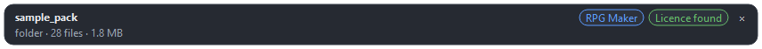

The card also says what the pack looks like when rpggen can tell: *Looks like a shooter pack*,
*Looks like a racing pack*, *Looks like a farming pack*, *Isometric tiles, 180 x 104* (the
diamond its tiles stand on, see [The isometric view](#3d-the-isometric-view)), or *art for 5
engines: Godot's is used* for a pack that ships the same pictures laid out for several engines
(the copies are set aside in the audit).

**A bundle of packs.** Some archives hold many packs: a folder for each, or a zip for each.
Adding one opens **Choose packs** instead: a row for every pack with its pictures and its size,
a search field, *Select all* and *Select none*, and what your choice comes to beside **Add**.
Up to twenty packs are all ticked to begin with; a larger bundle starts with none. Each pack
you tick becomes a pack of its own, named by its folder, and only those are unpacked. They
stand under a row for the archive; **Choose packs…** there opens the list again to add more or
to take one away (which asks first). The archive's licence is shown once, on that row. On the
command line the same is `--pack <archive> --pack-folder <name>`, once for every pack you want;
without `--pack-folder`, rpggen lists the packs of the bundle and stops.

Rarely, a pack has a password or contains something unsafe (ARCH-002, ARCH-003, ARCH-004); extract
it yourself and add the folder.

**A `.rar` archive** is opened with 7-Zip when it is installed, else with the `tar` that
Windows 10 and later have (it reads rar); without either it is refused with the reason
(ARCH-007), as a `.7z` is. That `tar` cannot read file names outside your system's code page:
such files are left out and said (ARCH-010).

**Packs that ship their art more than once.** Many packs have the same tiles in several forms:
a sheet with a pixel between the tiles, a packed sheet and a single file a tile (Kenney's
*Tiny* packs), or every crop as a strip of its own and all of them again on one sheet of the
season. rpggen finds such pictures **by their content** (every cell is compared), uses one
form and sets the others aside in the audit with the reason (*the same tiles as another
picture of this pack*, or *a sheet of pictures this pack also has a file each*); one click
there brings one back. The same picture twice is only noted, as before. An animated GIF that
shows a sheet the pack also has as a PNG is set aside the same way.

**A pack in several sizes** (LimeZu's packs at 16, 32 and 48 px, a folder or a name a size) is
used in one of them: the size your other packs use, else the smallest. The Audit page's
**Packs** tab has a **Tile size** choice on the card of such a pack; the other sizes are set
aside, and no tile set is made in a size the pack does not draw. In a farming pack a sheet
that was read as tiles of another size is cut again at the pack's size, or kept as a picture.

**Licences in a documentation file.** Besides `LICENSE`, `Credits` and `Readme`, rpggen reads a
licence from a text file called *Documentation*, *Terms*, *About*, *Info*, *Notice* and the
like, at the pack's root or one folder down (or at the root of an archive inside it), when the
text speaks of a licence, credit or commercial use. When the licence asks for credit, the
generated `README.md` has a **Credits** section that names the pack, its author, its licence
and its page, besides the game's Credits screen.

**A licence you state yourself.** A pack that has no licence file at all (many packs bought on a
store keep the licence on the store's page) gets the note ASSET-021. On the Audit page's
**Packs** tab, the card of such a pack has a **Credit line** beside the licence: choose the
licence and write the line the game should credit the pack with. rpggen keeps both with the
pack (and in the pack's profile when you export one), says ASSET-036 instead of ASSET-021, and
writes the pack into the README's **Credits** section, marked as your own statement and not
the pack's.

**AI-generated art.** On the same card, **AI-generated art** marks a pack whose pictures were
made with a generator (CuteSCKR's tile sets, for one: they need no licence recorded). The mark
is kept with the pack and in its profile. A game whose catalog uses any asset of such a pack
gets a section **AI-generated content** in its README: it names those packs and says that a
store page must declare them (Steam's AI disclosure, for one). It also suggests cleaning their
pictures up in Aseprite, by hand or with an AI assistant driving Aseprite, so that the art
becomes your own work on top of what was generated, and says that edited art still came from a
generator and is still declared. A game that uses none of them has no such section.

**Sheets of many things.** Some packs draw everything on a few large sheets:

* **Object sheets** (SakPix's stage packs: *13. Farm animals*, *6. Barns and silos*): the
  things lie loose on transparency under a banner with the sheet's name. Each is cut out as an
  asset of its own, named by where it lies on the sheet (`#o364_618`), with the role the
  sheet's name gives it: an animal, a building (when it is large enough to be one), a fence,
  a tool, a decoration. A sheet whose name says nothing gives things that need review. A sheet
  whose name says *tiles* holds loose squares of ground: each is cut to the square all of them
  hold, and large squares are cut into quarters (never scaled) to make a tile set.
* **Mixed tile sheets** (CuteSCKR's tile sets: sheets of 48 px cells mixing ground, fences,
  crops, buildings and things): a pack that calls itself a tile set has its sheets sorted cell
  by cell. A patch of whole cells that tiles is ground; a thing drawn over several cells is
  kept as one object; a cell alone is a decoration. In a farming pack a row of growth stages
  (a plant on its mound of soil in each cell, growing from one cell to the next) is a crop,
  named *Crop 1*, *Crop 2* ... since nothing names it, and the farm grows it. Most of the
  other things need review: their sheets name nothing. A house of such a sheet is a building
  once you give it the role.

In both cases the sheet itself is set aside, with the reason, and its parts are the assets.

**Characters in a folder of facings.** A folder whose pictures or sub-folders are named by a
direction (`rotations/east.png`, `north-east.png`; or `NE`, `NEE` as *Lords Of Pain* names its
sixteen) is one character: an animation a facing for every action folder beside it (`walk`,
`attack`, ...). Of sixteen facings the eight the game turns by are used (ADAPT-008 says so and
the card is tagged *facings:16*); a character with nothing but its still pictures walks in
them. A prop drawn the same way is one decoration.

**Archetype page.** Choose the kind of game:

* **Turn-based**: encounters on the map start a battle screen with attack, defend, item and run.
  Up to four characters can fight together (the demo villager can bring a companion along).
* **Action RPG**: real-time sword swings with hitboxes, enemies that chase and attack, a HUD.
  Party members follow the player, and the first two help in a fight: they walk to an enemy
  near you and strike with their own attack; at 0 HP they are only down for a few seconds.

* **Metroidvania**: seen from the side. You run, jump and climb through joined rooms, fight in
  real time, and find abilities (a double jump, a dash, …) that open new ways. It has its own
  section: [Metroidvania](#3a-metroidvania).
* **Shoot 'em up**, **Run and gun** and **Racing**: three arcade games with stages, lives and
  a score. See [The arcade kinds](#3b-the-arcade-kinds).
* **Farm**: crops through days and seasons, a shop, animals and a village to get to know. See
  [Farm](#3c-farm).

There are seven cards: in rows of four in a wide window (1280 px and more), in rows of three
below that, where the third row is reached by scrolling, and in one column in a narrow window.
Under the cards rpggen says what it saw in your packs: that a pack looks made for one of the
kinds, or that it *is isometric*, a view four of the kinds have (see
[The isometric view](#3d-the-isometric-view)).

You can generate another kind later in a new project; the shared systems (saving, dialogue,
inventory, equipment, menus) are the same.

**Audit page.** rpggen has guessed what every file is. This is where you check the guesses.

* The grid shows thumbnails with a coloured edge and a small glyph in the corner, so the state
  can be told without colour: ✔ green = confirmed, blue = auto-detected, ? orange = needs
  review, ! red = conflict, ∅ purple = missing from the pack, grey = unused. The chips above
  filter by status; it opens on **Needs attention**. Filters also exist for role, pack and a
  path search. A sound's card shows its waveform and its length; a recolour variant has ⧉ in
  the corner of its picture.
  All of these are one row above the grid: the chips, the two lists, the search box, the
  folder button and, at its end, **Profile**. The page's header has the count of what you have
  reviewed with its bar and the **Review mode** button; the line under the grid says how many
  assets still need attention and names the keys, with **Shortcuts** for the whole list.
* **Group by folder** (the list-shaped button in that row): a header per pack folder with how many of
  its assets are shown and the buttons *Confirm all*, *Select all* and *Make rule…*; click a
  header to fold the folder away.
* **Review mode** (*View → Review mode*, `F7`): one asset at a time, large, with its details
  beside it. `C` confirms and `X` excludes and both move on, `N` and `Shift+N` step, `1`-`9`
  set a role, and `Esc` or `F7` returns to the grid. A counter says how many are left.

  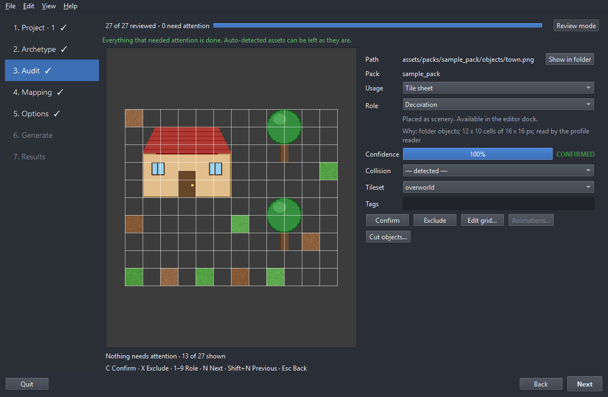
* **The tour.** The first time the page opens, a short tour points at the parts of the page one
  after the other (*Skip* or `Esc` closes it). *Help → Show the tour again* brings it back.
* **The queue.** After the first look the page works through what needs attention: `N` and
  `Shift+N` jump to the next and the previous asset that does, and a line under the grid says how
  many are left and when the queue is empty.
* Select an asset to see its details on the right: usage (tiles, sprite, icon, ...), role (what
  the generator uses it for, e.g. GROUND, WALL, PLAYER, ENEMY), tile grid, collision, tile set,
  tags. Change a value and the thumbnail updates; **Confirm** marks an asset as checked,
  **Exclude** leaves it out. Everything is undoable (Ctrl+Z, Ctrl+Y). A sprite with animations
  plays in the panel: choose the animation, play or pause it, and see the frame number, with
  the origin and the collision shape drawn over it.
* **Sounds.** A sound shows its waveform with a play head while it plays. Music also has a
  **Loop** row: where the track jumps back to and from, in milliseconds. Drag the two markers on
  the waveform or type the numbers; **Guess** looks for the longest stretch after which the
  track goes on as before, and **Whole track** takes the points away. In the game music loops
  between these points (a WAV between both; an OGG or MP3 plays to its end and comes back to the
  start point).
* **Select similar** (`Ctrl+Shift+S`, or right-click → *Select similar*): selects the assets
  that look like the selected one, so that a set of look-alike sprites gets its role in one go.
  The same picture shipped twice in different packs is tagged `duplicate_of:<id>`.
* **LPC characters.** A character of the Liberated Pixel Cup collection comes in parts: a body,
  and hair, a head, clothes and a weapon drawn over it. rpggen reads every part and puts a
  character together by itself when a pack leaves no choice (one body, one layer of a kind).
  Where there is a choice, right-click the body (or the character) → **Compose LPC
  character…**: pick one layer of each part, or none, see the character as it stands, and
  give it a name. The character is an asset of its own, one sheet with every animation its
  body has; the parts stay unused by themselves, each with the reason on its card. *Remove
  character* takes one away again and frees its body. A layer that has no picture for an
  animation (a hat without a *run*) is not drawn in it.
* **Variants.** Right-click a sprite → **Make variant…** to get a second enemy from the one a
  pack ships: turn the hue (with saturation and brightness), or change single colours in the
  palette table (click a colour in the source picture to find its row, double-click the row to
  choose what it becomes), give it a name, and for an enemy set how its HP, attack, XP and gold
  compare with the original. The variant is an asset of its own, rendered again from its source
  whenever you generate, and an enemy variant gets its own file in `game/data/enemies/`; it is
  not placed on the demo maps. *Remove variant* takes it away again. If the source leaves the
  pack the variant is left out with ASSET-029 until it is back.

  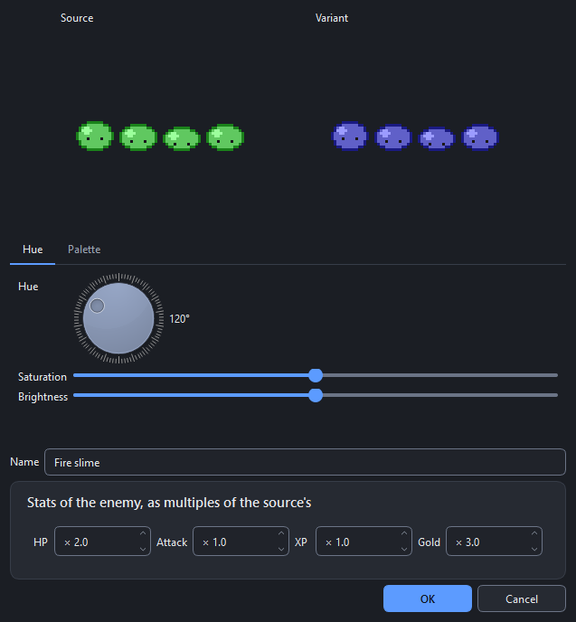
* **Keys:** `C` confirm, `X` exclude, `N` / `Shift+N` next / previous asset that needs
  attention, `1`-`9` quick roles, `Ctrl` + mouse wheel zooms the grid (or use *View → Thumbnail
  size*). *Help → Keyboard shortcuts* lists them all; `Alt+N` and `Alt+B` are Next and Back.
* **Bulk actions:** select many assets (Ctrl/Shift-click) and use the panel at the bottom: every
  combo reads "— unchanged —" until you pick something.
* **Rules:** right-click an asset → *Make rule for this folder…* so that everything in a folder
  (a glob such as `characters/**`) gets the same role or tags, now and after pack updates. The
  *Rules* tab lists them; drag to reorder.
* **Grid editor** (*Edit grid…*): cell size, margin and separation with a live readout
  (`12 × 4, 47 non-empty, remainder 0 px`) and the five best candidates. ASSET-003 appears here
  when the sheet does not divide evenly. For a picture of an isometric pack it draws the
  diamond the tile stands on, which you can change there.
* **One card for several pictures.** A picture a pack ships in several colours is one card
  with a **Variants (n)** row in its details; a tile turned several ways has **Turns (n)** and
  a sheet that comes once a season **Seasons (n)**. The two buttons of the row show every
  member as a card of its own, or select them all to change them together.
* **Animations** (*Animations…*): a direction-grouped list of animations with playback, click the
  sheet to pick frames, mirror left from right, reverse, ping-pong, origin and baseline, and
  *active frames* (the hit frames) for the action RPG. An animation saved as one numbered image
  per frame (`hero_walk_down_01.png`, `hero/walk/0001.png`, `Walk (3).png`) is read as one
  animation when its name has an action word such as walk, attack or cast; a missing number in
  the row gives ADAPT-004 and the frames that exist are used. Characters drawn in eight directions
  (`walk_down_left`, `walk_ne`) use the diagonal pictures while they move diagonally.
* **Object cutter** (*Cut objects…*): draw rectangles around a house or tree in a sheet, set its
  footprint (where it blocks), door and origin. Detected objects appear blue, yours green.
* **Terrain tab:** autotile proposals for RPG Maker A2 sheets and 47-tile blob sheets. A blob
  sheet is 12 tiles by 4 (192 x 64 for 16 px tiles) in the order of Godot's *3x3 minimal*
  template, which is how most packs ship one, or with the tiles in the order of their
  neighbour masks. It is recognised in a folder or under a name that says *tileset*,
  *autotile* or *terrain*; accept the proposal and the tiles join by themselves when you
  paint. A fence or wall sheet of the same shape is not a blob terrain and stays plain tiles.
* **Terrains inside a sheet** (from release 1.5) need no proposal. Most packs keep their
  terrains as blocks inside a larger sheet of ground, water, paths or soil: a 47-tile blob in
  Godot's template (EmanuelleDev's *Farm RPG* repeats it down its sheets), a block of 3 x 3
  with its four inner corners beside it (LimeZu's *Modern Farm*), a 16-tile corner or edge set,
  RPG Maker's block of 2 x 3, the beds one cell wide of Kenney's *Tiny Farm*. rpggen finds them
  by comparing the edges of the cells (where the terrain goes on they meet without a seam,
  where it ends they do not), over another ground or over transparency, and gives their tiles
  a terrain in the TileSet with the peering bits Godot paints with; plain cells of the same
  surface that tile with a terrain's middle become its variants, laid less often. You see the
  result in Godot's TileSet editor (*Terrains*). A sheet of objects (houses, crops, icons) is
  not searched.
* **Packs tab:** the licence, author and URL rpggen read from each pack's licence files, and
  whether the licence asks for credit. Correct anything that is wrong: the game's *Credits*
  screen (title screen and pause menu) lists every pack with these values. A pack that needs
  credit but names no author gets ASSET-028 until you enter one.
* **Profile menu:** export your audit as a profile, import one, or find one online
  ([profiles](profiles.md)).
* **Learning from your fixes.** When you change the role, usage or collision of a few files that
  share a folder or name word, rpggen remembers it and proposes the same for new packs. Such an
  asset stays *Auto-detected* (to be reviewed) and its *Why* line says *learned from your earlier
  fixes (n times)*. A rule is used after two fixes and when you do not keep correcting it; **Edit
  → Learned rules…** manages them.
* **Contact sheet:** *Profile → Export contact sheet…* (or *File → Export contact sheet…*)
  prints the assets on A4 or Letter pages, as a PDF or one PNG per page, for review away from
  the computer: each asset's picture (optionally with its tile or frame grid), file name, role,
  status, confidence and tile or frame size. It takes the assets the grid shows now (your
  filters) or all of them.

**Mapping page.** A checklist of what the starter map and the systems need: ground, wall, player,
NPC, enemy, chest, building, UI and so on. Each row shows the chosen asset. Its list offers the
best candidates that could plausibly fill the role; **More…** opens all of them as a gallery of
thumbnails, grouped by pack with the best candidate first and a search box. The three small
buttons at the end of a row open that gallery, show the chosen asset on the Audit page (*Back*
returns) and clear the row, which goes back to the automatic choice; each says what it does
when the mouse rests on it. The header counts the roles that are filled and has **Undo**; a
required role without an asset has a warning edge. If a required role has no asset you can continue with a
**placeholder** (a labelled debug picture, ASSET-010) and fix it later.

**Sound.** Under the roles, the *Sound* section lists **sound slots**: the map, battle and title
music, the menu cursor, confirm and cancel sounds, and the sounds of a hit, an attack, a
pick-up, a chest, a door, a footstep, saving and a level-up. rpggen fills each slot from the
audio of your packs by file name; *Edit…* shows a row per slot with **Choose…** (a list of the
audio files, with ▶ to listen and the length of each), **▶** and **Clear**. A cleared slot is
silent. A pack without audio simply gives a silent game. **Add slot…** makes a slot of your own
(`sfx_<name>` or `music_<name>`): play it with the dialogue event `play_sound:<slot>`, the
`play_sound` step of a cutscene or `SceneRouter.audio.play(&"sfx_<name>")`. A slot named
`sfx_step_<surface>` is the footstep on ground of that kind (grass, stone, wood, water, sand):
rpggen reads the surface from a ground sheet's folder and file names and fills these slots
from files such as `step_grass.wav`.

**Options page.** Features (dialogue, combat, saving, demo content, editor tools, debug tools),
resolution and window mode, the **layers** of the map (Ground is always there; add Decoration,
Collision, anything), and under *Advanced* the random seed, key/gamepad bindings and the option to
**initialize a git repository** and commit.

* **Presets.** *Save as preset…* keeps the options for your next project; *Manage…* renames or
  deletes them. A preset only fills the options, never the packs or the folder, and *Reset to
  defaults* (beside the presets, in the page's header) returns to the factory values. Three presets come with rpggen and cannot be deleted:
  **Everything**, **Minimal** (tile sets, collision, animations, saving and dialogue) and
  **Just the tilesets**.
* **Options that need each other.** A feature that needs another one is greyed out while that
  one is off, with a line saying what it needs (the demo content needs tile sets, dialogue,
  combat and saving; enemy pathfinding needs combat). Switching the needed one back on
  restores what you had chosen.
* **View.** When one of your packs has isometric pictures, the box of a turn-based RPG, an
  action RPG, a farm or a racing game has a **View** choice, *From above* or *Isometric*; see
  [The isometric view](#3d-the-isometric-view). With packs of square tiles alone there is no
  such row.
* **Starter map.** The *Starter map* box sets the size in tiles (24 to 96, with the names Small,
  Medium and Large), the ground set, how many buildings, villagers, enemies, chests,
  decorations and ground patches. The picture beside it is the real plan, drawn from your assets:
  *Reroll* picks a new seed (under *Advanced*). With the default settings the map is the one earlier versions made. A project that
  already has a starter map keeps it; the box then says so and the preview is switched off.
  Every house on the map has its own interior (`interior_1`, `interior_2`, ...), and leaving it
  brings you back to the door of that house.
* **A world of several areas.** *Make a world of several areas* in the same box turns the
  project into several connected maps. The table has a row per area: a name, a **biome**
  (village, field, forest, cave or shore), a size, and how many enemies and chests; *Add*,
  *Remove*, *Up* and *Down* edit it and *Undo* (Ctrl+Z) takes a change back. The village is the
  starter map. rpggen lays the areas on a grid around it, joins neighbours with doors, fills a
  forest with trees and a shore with water, and puts one **key** in a chest somewhere you can
  reach before the gate that closes the first cave. A biome your packs cannot fill becomes the
  one before it in that list, and the report says so. The picture under the table shows the
  world as one tile per area with a dot for every door; click an area to see what stands in it,
  and *Rearrange this area* gives that area another arrangement. Once the project has been
  generated the world is fixed: the table says so, and the only change it still takes is a new
  row, joined to the area you pick. See [regeneration](regeneration.md#the-world-of-areas-and-its-repair).

  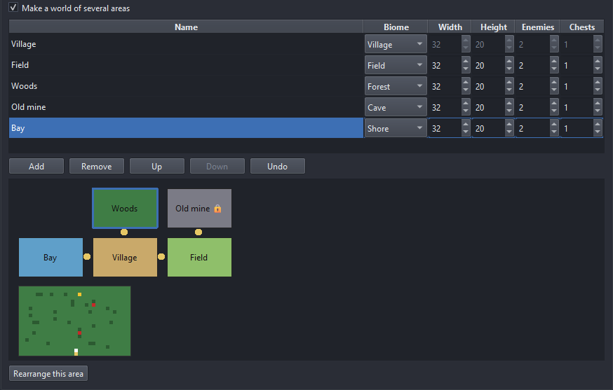

* **Imported maps.** A pack that ships Tiled (`.tmx`, `.tmj`) or LDtk (`.ldtk`) maps lists them in
  the *Imported maps* box, each with a checkbox. A checked map is built into
  `game/maps/imported/<pack>/` (nothing is built unless you check it). The *Starter map* list under
  it can make one of them the starter map: the layout options above are then skipped, and that map
  has none of the demo's villager, chest or enemy (put your own in Godot). Tile layers go into the
  map layer of the same name (see *Map layers*) or become a layer of their own; flipped tiles keep
  their flips; the solid values of an LDtk IntGrid layer block the player (*Solid values…* chooses them; a value named wall, solid or collision starts solid); objects on layers named
  `spawn`, `door` or `sign` become spawn points, doors (properties `target_map`, `target_spawn`)
  and markers with a `text`. Layers saved with zlib, gzip or Zstandard compression are read.
  Like the other maps these are yours: regenerating never rewrites them. An **isometric** Tiled
  map is a map of an isometric project, and a map of squares (Tiled or LDtk) of a project seen
  from above: a checked map of the other view is not built, and the run says so (TILE-013); see
  [The isometric view](#3d-the-isometric-view). A staggered or hexagonal map is not read
  (TILE-009 says why).
* **Export targets.** Each checked platform gets an export preset in `export_presets.cfg`, so
  *Project → Export…* in Godot is ready to use: **Windows** (on by default, one `.exe` with the
  game inside), **Web** (`export/web/index.html`; thread support is off, so the build runs on
  itch.io without special server headers), **Linux** (`.x86_64`) and **macOS** (a `.zip` with an
  ad-hoc signature: no Apple developer ID and no notarization, so players must right-click →
  *Open* the first time; set your own bundle identifier in place of `com.example.<name>` before
  you publish). The export check test-exports each checked platform whose export templates are
  installed and notes the others (ENV-010). Checking a platform later adds its preset when you
  regenerate; presets already in the file, and your changes to them, are never touched.
* **Version control.** With *initialize a git repository* on, each generation is committed.
  Most pack licences forbid sharing the art, so a second choice says what happens to
  `assets/packs/`: *Commit the pack art with the project* (the default, a safe private copy),
  *Leave the pack art out of git* (it goes in `.gitignore`; use this before you push to a public
  host) or *Use Git LFS for the pack art*. See [regeneration](regeneration.md#git).

**Generate and Results.** Generation runs on a copy (`.rpggen_staging`) and only a validated,
smoke-tested result replaces your folder, so a failure never leaves a half project behind.

* The page leads with a picture of the starter map that was generated (click it to open the
  file) and a *What next* list: press F5, paint on the map, drag objects from the dock, edit the
  items, read the project's `README.md`. While it runs the page shows each phase with its time
  and, from the second generation on, how long the rest will take (from how long the phases
  took before on this computer); the taskbar button shows the progress, and a notification
  tells you when it is done if the window is in the background.
* **Open in Godot / Open folder / View report** (`GENERATION_REPORT.md` explains what was
  generated, what to review and the packs' licenses).
* **Restore previous** undoes the last regeneration.
* **Repair the world…** appears beside a warning about a door that leads nowhere or a map that
  cannot be reached. It shows what it would add before it writes, and saves the maps first.
  The maps rpggen made itself are mended without asking
  ([regeneration.md](regeneration.md#the-world-of-areas-and-its-repair)).
* **Notes (n)** lists what is worth knowing but did not stop the run, starting with the **checks
  that did not run** (for example the export check without export templates, or a check you turned
  off), each with the reason. `GENERATION_REPORT.md` has the same list under *Checks not run*.
* **Resolve conflicts…** appears when generated files you changed have a new version beside them
  (`.rpggen-new`): keep yours, take the new one or merge the two, file by file
  ([regeneration.md](regeneration.md#resolving-conflicts)).

  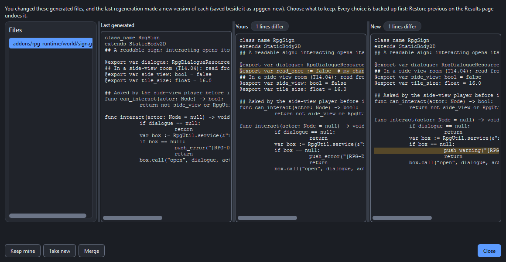
* Under the picture the counts (assets, TileSets, scenes, animation sets, warnings, errors)
  are tiles; a regeneration that found nothing changed says so here and on the Generate page,
  where the checks it did not repeat have a dash ([regeneration.md](regeneration.md)).
* **After a failure** the page says which step failed and shows what to do about it: the
  problem with its fix, and under it what Godot itself reported (*Godot said: …*, with the file
  and the line when Godot named them) and the last 30 lines of that step's log (**Show more**
  for the rest). The buttons under the problem act on it: **Open the log**, **Show this asset
  in the audit** when the file belongs to one of your assets, and **Open failed folder**;
  **Export diagnostic bundle** packs everything for a bug report.

  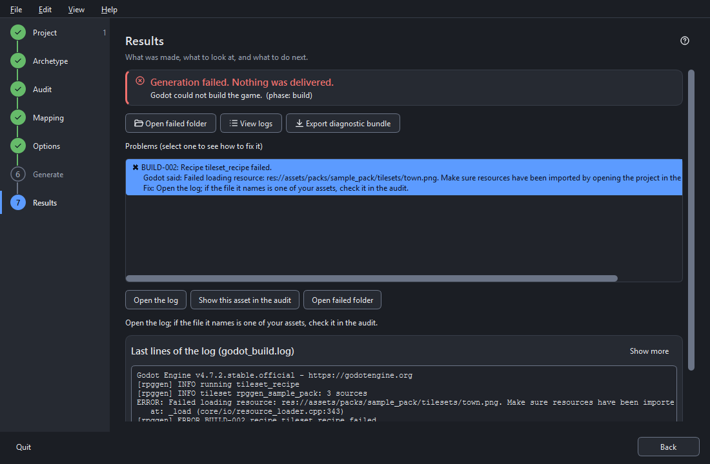

## 3a. Metroidvania

The third kind of game is seen **from the side**: you run and jump through rooms that are joined
into one world, and some ways are closed until you have found the ability that opens them.

**Trying it.** On the welcome view, **Choose a sample** on the *Try the sample* card lists the
samples, among them the *Top-down village* (what a click on the card itself gives) and the *Side-view cave*. The cave
is a small pack made for this kind of game (cave tiles, planks, ladders and spikes, a hero with
run, jump, fall, climb, dash and attack animations, a crawler and a bat, a guardian, a hermit,
two ability orbs, three background layers and sounds). Choosing it fills in the pack, chooses
**Metroidvania** and starts generating; **Back** returns to the options while nothing was
written yet.

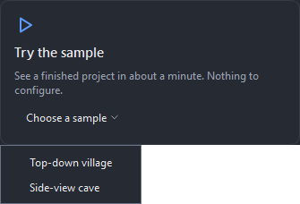

**Choosing it for your own pack.** On the Archetype page pick the **Metroidvania** card. Under
the cards rpggen says what it saw in your pack: *This pack looks side-view* (platform tiles,
ladders, spikes, backgrounds in layers, a character that faces left and right), or that *your
characters have walk-down animations*: the card can still be chosen, but a top-down character
will look odd running sideways. A player without a `jump` or `fall` animation shows its idle
frame in the air; the page says so, and the report lists it (ASSET-030).

**What the roles are used for.** The Mapping page lists the roles this kind of game uses:

| Role | Used for |
|------|----------|
| Player * | the hero, seen from the side |
| Ground * | the floors and walls of every room |
| Background | the pictures behind a room; several scroll at different speeds (parallax) |
| Decoration | scenery in the rooms |
| Enemy | the creatures in the rooms |
| Boss | the guardian |
| Item | pickups and chests |
| NPC | the characters you talk to |
| UI, Portrait | menus and dialogue |

Only the two with a star are required. What your pack lacks is drawn by rpggen: a pack without
one-way platforms, ladders, spikes or breakable blocks gets plain ones in its tile size, and
without an enemy or a guardian the first ability lies in its room as a pickup instead. On the
Audit page a tile's **collision** can be *One-way* (a plank you can jump up through) or
*Ladder*, and the tags `hazard` and `breakable` mark spikes and blocks. The Sound section has
four more slots: **Jump**, **Land**, **Dash** and **Ability**, filled by file name like the
others.

**Packs as they come (since T17.32).** rpggen reads the shapes side-view packs are sold in, for
the metroidvania and the run and gun alike:

* **A tile sheet whose tiles nothing names** (Kenney's pixel platformer packs, ansimuz's and
  pozak's tile sets): the pictures say which tiles are the ground (its surface on top, its
  ends, its inside, the faces under it), a plank to jump through, a ladder, spikes, water or
  a coin; the rooms and stages are painted with that ground, its grass on top and its ends
  rounded. A tile the pictures leave in doubt (a door, a key, a flag, a sign) is not used,
  and the report counts them (TILE-016); you can give one its collision on the Audit page.
  The numbered copies of the same tiles (`tile_0001.png`) are set aside.
* **A sheet of characters** beside the tiles (`tilemap-characters.png`) is characters: each
  run of alike frames is one, the first the player, the others enemies.
* **Ground pieces named by their place** (`grassLeft`, `grassMid`, `grassRight`, `grassCenter`,
  `grassHalf_left`, `grassCliff_right`, `grassHill_left`) are put together into one tile sheet
  a surface (`generated/side_terrain/`) and the rooms are painted with them; the `Half`
  pieces are planks to jump through. A sign, a door or a ledge's decoration is no ground.
* **Characters as folders of frames** (`Hell-Hound/Sprites/Idle/frame1.png`,
  `Ogre/Sprites/walk-unarmed/...`, `alienBeige_walk1.png`, `alienBeige_jump.png`): one
  character with its animations named by the folders or the files; the same animations as
  strips (`Spritesheets/`) and previews (`.gif`) are set aside. A character whose folder or
  files say *player*, *hero* or *heroine* is the player, a *boss* the guardian, the others
  enemies.
* **Background layers** in a folder (`Background/1 (2).png` to `1 (5).png`, `back`, `middle`,
  `front`, `sky`, `clouds`) are one parallax set, far to near by their names, their numbers
  or how much of each is see-through; a room or a stage uses the set nearest its ground's
  sheet. A folder of whole pictures (several backgrounds to choose from) is no set.
* **Props** are decorations, never characters. **One tile size a pack**: a sheet in another
  size than the pack's ground is cut again at that size when it divides it, else it is a
  picture.
* **A licence file one folder above** a pack you add on its own (`Assets/license.txt` beside
  `Assets/Gothicvania/`) is the pack's licence, and the pack's notes in the catalog say where
  it was found (`licence_above:license.txt`).

What is left to you: animations that nothing names (pozak's beat-'em-up characters are one
sheet of 16 rows without names: give the rows their names in the audit's *Animations…*
dialog), and a pack drawn very large (Kenney's 128-pixel *Platformer Pack Remastered*): raise
the resolution on the Project page so that a room shows more than five tiles across.

**The world options.** On the Options page the *Starter map* box is the **Starter world**:

* **Rooms** (5 to 12) and the **room width** and **height** in tiles. A room is at least one
  screen large.
* **Abilities**, in the order they are found: *Double jump*, *Dash*, *Wall jump*, *High jump*
  and *Break blocks*. The first one is guarded by the guardian; each of the others lies in a
  room of its own. Every ability needs a room, so the number of rooms can never be lower than
  the abilities plus three; the box raises it for you.
* **Enemies** per room and **pickups** (potions and coins) in the whole world.
* The picture is the plan, seen from the side: one box per room where it lies, the exits
  between them, a letter where an ability is needed (**J** double jump, **D** dash, **W** wall
  jump, **H** high jump, **B** break blocks) and marks for the start, the save station, the
  guardian and the end. *Reroll* under *Advanced* gives another world.
* **Added rooms.** A row with a name and the room it lies beside makes one more room. This is
  also how a world that exists grows: once the project has been generated, the other options
  are fixed (the box says so) and a new row is the one change the world still takes.

There is no pathfinding in rooms, so *Navigation* is not offered, and the layer list shows the
layers every room has (Background, Ground, Platforms, Hazards, Decoration, Foreground).

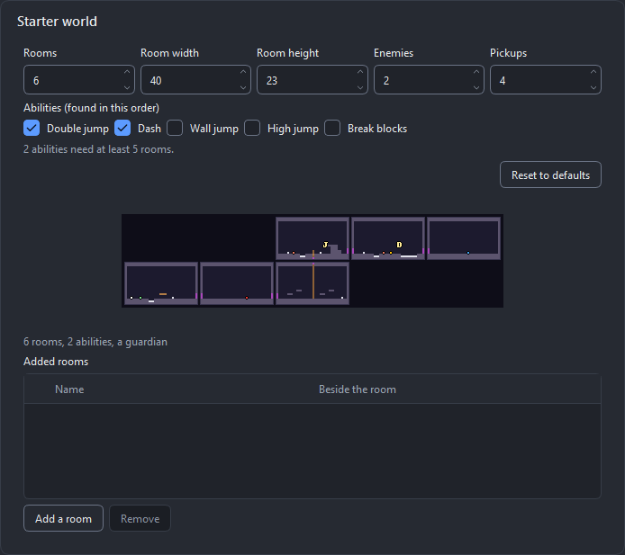

**Playing.**

| Action | Keyboard | Gamepad |
|--------|----------|---------|
| Run | A / D, Left / Right | D-pad, left stick |
| Jump | Space, Z | A (cross) |
| Drop through a platform | Down, then jump | D-pad down, then A |
| Climb a ladder | Up / Down | D-pad, left stick |
| Attack | J, X, left mouse button | X (square) |
| Dash (once you have it) | Shift, C | right stick button |
| Talk, read, use | E, Up | Y (triangle) |

* A jump is as high as you hold the button. You can still jump for a moment after walking off
  an edge.
* **Abilities** are found as orbs, or given by the guardian. A toast says what the new ability
  does and which key uses it; the HUD shows the abilities of the world and lights the ones you
  have. A ledge that was too high, a gap that was too wide or a wall of cracked blocks is then
  a way on.
* **Rooms** change as you walk through an exit: no fade, the camera slides over. The exits of
  the guardian's room are closed while it lives.
* **Save stations.** You save only at a save station (a bench in the first room): interact with
  it to rest, which restores your health and brings ordinary enemies back, and to choose a slot.
  The game also saves by itself on every room change. At 0 HP you return to the last station
  you used, with everything you had.
* **The map.** The minimap shows the rooms you have been in, with a mark for a station and for
  an ability that still lies in a room; *Pause → Map* shows the whole world you have seen.
* The game ends with the hermit in the last room, who has the last word and the credits.

**Editing rooms in Godot.** Every room is a scene in `game/maps/rooms/`. Paint on its layers
with the TileMap editor, drag enemies, pickups, chests, signs and save stations from the **RPG
Project Tools** dock under `Entities` (an object dropped in a room lands on the floor below the
mouse), and move the exits on its edges. A room that exists is never built again, so what you
change is kept when you regenerate. The project's `README.md` has the details: the parts of a
room, abilities and gates, enemies by tag, and the guardian.

**Adding a room.** Either add a row under *Added rooms* in the wizard and generate again (the
new room is built and the room beside it gets its exit), or duplicate a room scene in Godot,
give it a new **Map Id** and set the **Target Room** and **Target Exit** of the exits on both
sides. The validator reports an exit that leads nowhere (VAL-028) and can fix it; see
[regeneration](regeneration.md#rooms-and-the-stored-plan).

## 3b. The arcade kinds

Three more kinds of game are **arcade games**: a run through stages (or races) with lives and a
score, a boss at the end of each stage, a *Continue?* screen after the last life and a table of
the ten best runs on the title screen. They have no village, no dialogue, no inventory and no
party; those features start switched off for them and stay available.

| Kind | Seen from | The game |
|------|-----------|----------|
| **Shoot 'em up** | the top (it scrolls up) or the side (it scrolls right) | a ship over a scrolling background, waves of enemies, power-ups, a boss |
| **Run and gun** | the side | a soldier who runs, jumps, aims in eight directions and picks up weapons; with the grapple arm it swings and hoists |
| **Racing** | the top, or at an angle (see [The isometric view](#3d-the-isometric-view)) | a car against rivals round a track, over laps with checkpoints and pickups, through a championship |

What is the same for the three:

* **A sample of its own.** *Choose a sample* on the welcome view lists seven, among them
  *Star lane* (a shoot 'em up), *Jungle line* (a run and gun) and *Dirt cup* (racing). Each
  fills in its pack, chooses its kind and starts generating.
* **Any pack makes a game.** What a pack lacks is drawn by rpggen in the pack's tile size: a
  bullet, a laser, a missile, an explosion, a power-up capsule, a ship, a car in sixteen
  headings, a road, a hook. The report says so with a note (ASSET-031), never an error, so a
  plain RPG pack chosen as a shoot 'em up plays, with its hero as the ship and its monsters as
  the enemies.
* **Roles.** The Audit and Mapping pages have five roles these kinds use: *Projectile*,
  *Vehicle*, *Explosion*, *Power-up* and *Hazard*. The Mapping page lists the roles of the kind
  you chose, with what each is used for, and the kind's own sound slots.
* **The plan.** The stages, waves, bosses and tracks are planned from the seed, shown as a
  picture on the Options page, and stored in the project (`rpggen/world_plan.json`). Once the
  game has been generated the plan is fixed; a row under **Added stages** (or **Added tracks**)
  is the one change it still takes. *Reroll* under *Advanced* gives another plan before that.
* **Yours to change.** The game reads `game/data/stages.json`, which is written once and then
  left alone. The project's `README.md` (section 22) explains every entry.
* **Saving.** The game saves by itself when a stage or a race begins; *Continue* on the title
  screen starts it again.

On the Archetype page rpggen says what it saw: *This pack looks like a shooter pack* (ships,
bullets, asteroids, a tall background) or a racing pack (cars, a road, a sheet of headings),
and a side-view pack fits a run and gun as well as a metroidvania.

### Shoot 'em up

**The roles.** *Player* (the ship) is the only one required, and even that is drawn when the
pack has none. *Enemy* pictures are shared out by size and by name: small ones are the
*popcorn* that flies in formations, a turret sits on the background, a large one is the carrier
that releases small ones; rocks and asteroids (*Hazard*) drift and split. *Boss*, *Projectile*,
*Explosion*, *Power-up* and *Background* (the layers that scroll) are used when the pack has
them. Sound slots: **Shoot**, **Explosion**, **Power-up**, **Bomb**, **Stage music**, **Boss
music**.

**The options.**

* **Orientation**: *vertical* (the ship at the bottom, the game scrolls up, with the score and
  the lives in panels at the sides) or *horizontal* (the ship at the left, the game scrolls
  right).
* **Stages** (1 to 8) and their **length** (short, medium, long), **lives**, **bombs**,
  **auto-fire** (hold the button to keep shooting) and the **difficulty** (easy, normal, hard:
  how many bullets come and how fast).
* The picture is the **wave chart**: a column for each stage, read from the bottom up, a mark
  for each wave as wide as it has enemies, and the boss as a block at the top.

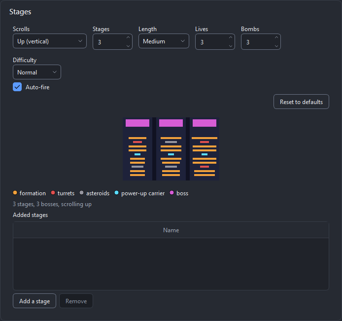

**Playing.**

| Action | Keyboard | Gamepad |
|--------|----------|---------|
| Fly | W A S D, arrow keys | D-pad, left stick |
| Shoot (hold) | Z, J, left mouse button | A (cross) |
| Bomb | X, K | B (circle) |
| Fly slowly (focus) | Shift | left trigger |

Only one point in the middle of the ship can be hit. A hit costs a life; the ship comes back
blinking. A bomb clears every enemy bullet from the screen. Power-ups drift toward you: a
weapon level (up to 3), another weapon (spread, laser, homing), a bomb, a life, a shield, or
points. The multiplier of the score grows while you are not hit.

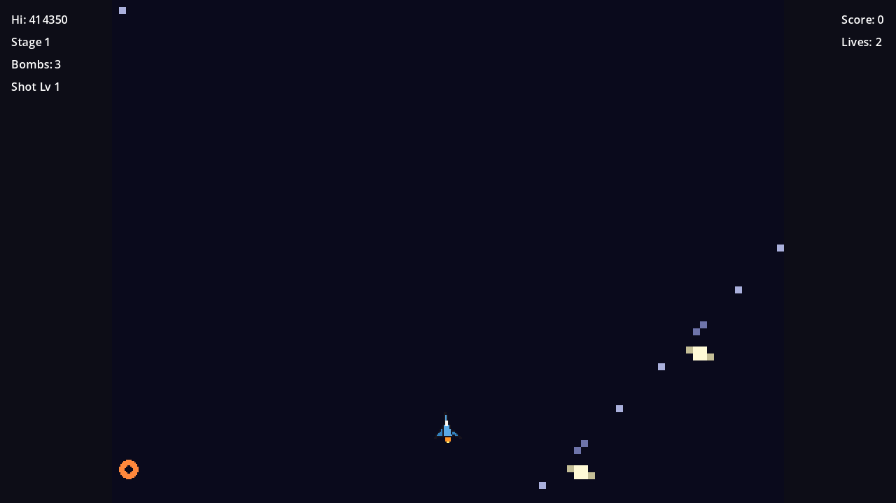

### Run and gun

**The roles.** *Player* (the soldier, seen from the side) and *Ground* (the tiles of the
stages) are required; a pack without platforms, spikes or a hook gets drawn ones, as a
metroidvania does. *Enemy* pictures become the runner, the sniper and the jumper in turn, and
one named turret or cannon the turret and the wall cannon; *Boss* is the boss of every stage
(a wall, a walker or a flyer). A soldier without `jump` or `fall` animations shows its idle
frame in the air (ASSET-030). Sound slots: **Shoot**, **Explosion**, **Grenade**, **Weapon
pickup**, **Grapple**, **Stage music**, **Boss music**.

**The options.**

* **Stages** (1 to 8), their **length**, **lives** and the **difficulty**.
* **Health** (1 to 5): with 1, one hit is a death, as the genre has it.
* **Keep the weapon** after a death, and **The left edge kills** (off: it is a wall).
* **Grapple arm** and **Jump**. *Jump* can be switched off only while the arm is on; the preset
  **Bionic** sets both, and the stages are then planned for the arm: a block to swing from
  over every pit and bed of spikes, planks to be hoisted on to beside every step.
* The picture is the **stage strip**: every stage from the side, with its ground, planks and
  spikes, the arena at its end, dots for the enemies, the weapons and the boss, and, for a
  soldier that does not jump, the tiles the arm can hold on to.

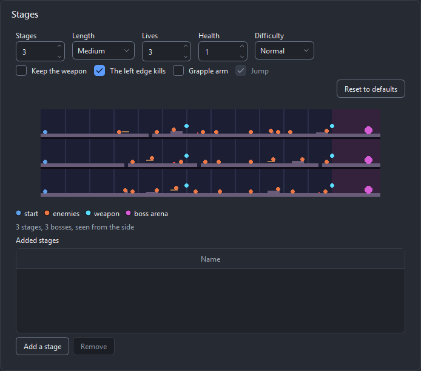

**Playing.**

| Action | Keyboard | Gamepad |
|--------|----------|---------|
| Run, aim | W A S D, arrow keys | D-pad, left stick |
| Jump | Space, Z | A (cross) |
| Shoot (hold) | J, X, left mouse button | X (square) |
| Grenade | K, C | Y (triangle) |
| Aim without moving | Shift | left trigger |
| Grapple arm | L, V | B (circle) |

You aim with the directions you hold. The camera follows you to the right and never goes back.
Weapons fly in on a carrier: shoot it and take what falls (spread, laser, flame). With the arm,
a hook that holds to the side makes the soldier swing (the button again lets go), and one that
holds straight above hoists it up.

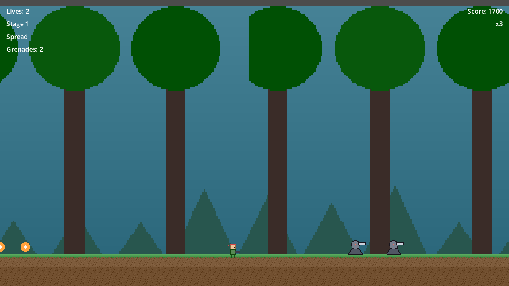

### Racing

**The roles.** *Vehicle* (your car) and *Ground* (the road) are required, and both are drawn
when the pack has neither. The best picture of a car is a **sheet of headings**: the car seen
from above in 16 directions (8 to 32 are read), the first pointing up and then clockwise. The
Mapping page shows the count beside the picture. A car that is one picture is turned by the
game (ASSET-032). Other *Vehicle* and *Enemy* pictures are the rivals; with too few, a rival is
your car in another colour. *Hazard* (a tyre), *Power-up* (the pickups) and *Decoration*
(trackside scenery) are used when the pack has them. Sound slots: **Engine**, **Skid**,
**Bump**, **Pickup**, **Lap**, **Countdown**, **Race music**, **Results music**.

**The options.**

* **Tracks** (the races of the championship), **laps**, the **track size** (small, medium,
  large) and the **difficulty** (longer tracks with more corners and more on the road).
* **Rivals** (0 to 5; with none it is a race against the clock) and **Rubber band** (rivals far
  ahead of you ease off).
* **Steering**: *relative* (left and right turn the car) or *absolute* (the car turns to where
  the stick points, which newcomers find easier). The preset **Sunday drive** is absolute
  steering, two rivals and the rubber band.
* **Camera**: *follow* (ahead of the car, zooming out with speed) or *fixed* (the whole track).
* **Elimination**: a player who comes in last twice is out.
* The picture shows every **track** from above: the road, the start line, the checkpoints, the
  oil, dirt and boost arrows on it, the pickups, and the car on the grid.

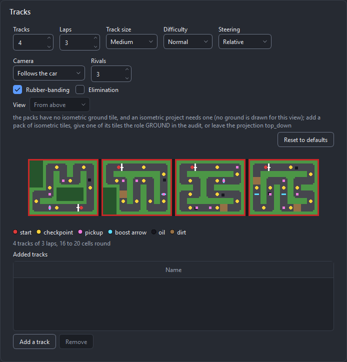

**Playing.**

| Action | Keyboard | Gamepad |
|--------|----------|---------|
| Accelerate | Up, W | A (cross), right trigger |
| Brake, then reverse | Down, S | B (circle), left trigger |
| Steer | Left and Right, A and D | D-pad, left stick |
| Boost | Shift, Space | X (square) |
| Use the weapon | X, K | Y (triangle) |

A race begins with a countdown. A lap counts at the start line, and only when every checkpoint
was passed in its order. The road is fastest; dirt and grass slow the car, oil takes the grip
away, an arrow is a boost for free. Pickups on the road are a boost, a missile, a bomb, a
shield, and one part a track (speed, tyres, acceleration) that stays on the car. After each
race a screen shows the result and the table of the championship: 10, 6, 4, 3, 2 and 1 points
for the first six.

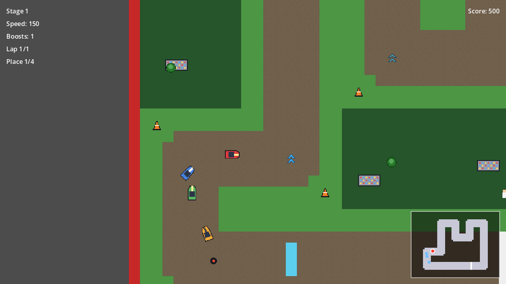

### From the command line

`rpggen generate --archetype shmup` (or `run_and_gun`, `racing`) makes the kind without the
wizard; `--dry-run` says what would be planned (*3 stages, 30 waves, 3 bosses*; *4 tracks of 3
laps, 3 rivals*). See [Running rpggen from a script](#7a-running-rpggen-from-a-script).

## 3c. Farm

The seventh kind of game is a **farm**: you till the ground, plant, water and harvest through
days and seasons, sell what you grow, keep animals if you like, fish, and get to know the
people of a village. It is a top-down game like the turn-based RPG, with the same maps, doors,
dialogue, inventory, shop and saving; it has no fights.

**Trying it.** On the welcome view, **Choose a sample** lists *Green acre*, a small pack made
for this kind: a farmer who walks and has a strip for each tool, four crops as growth strips,
tilled and watered soil, grass once for each season, a hen and a cow, five tools, a house, a
coop and a barn, three villagers, rain, music for the four seasons and eight sounds. Choosing
it fills in the pack, chooses **Farm** and starts generating. The game begins in the
farmhouse, by the bed.

**Choosing it for your own pack.** On the Archetype page pick the **Farm** card (the seventh:
in a window narrower than 1280 px it is in the third row, so scroll down). For a pack that has
crops, soil and farm animals, rpggen says under the cards *This pack looks like a farming pack:
a farm fits it*, and the pack's card on the Project page says *Looks like a farming pack*.
What rpggen looks for:

* **Growth strips.** A crop is one row of pictures, its stages from left to right, the last
  one ripe: `corn_16x32_8frames.png`, `wheat_growth.png`. rpggen takes a strip for a crop when
  its name is a crop's (corn, wheat, tomato, carrot, pumpkin, turnip, …) or says *crop* or
  *growth*, and has no action word (walk, attack) and no direction. A strip of tall frames in
  a folder named crops, plants, seeds or farming is offered as one and asks for your review.
  How many days a crop takes is not in a pack: rpggen gives each crop its days from the
  number of its stages. A crop that is a **single picture** grows through stages rpggen draws
  up to it (the note ASSET-034).
* **Words in folder and file names** give tags: soil (`soil`, `tilled`, `farmland`), watered
  soil (`watered`, `wet_soil`), tools (`hoe`, `watering_can`, `sickle`, `axe`, `rod`; `water`
  in a folder of tools is the can), animals (`cow`, `hen`, `chicken`, `sheep`, `pig`, …),
  their products (`egg`, `milk`, `wool`), `coop`, `barn`, `fence`, a shipping bin, weather
  (`rain`, `snow`: an overlay over the screen, never a tile), `fish`, `forage`.
* **Seasons.** The same sheet in folders or with words *spring*, *summer*, *autumn* (or
  *fall*) and *winter* is one card in the audit with a **Seasons (4)** row, as colour variants
  are one card with *Variants*. The map is laid with the first season's sheet and the game
  swaps the sheets with the calendar.
* **The farmer's tool strips** (`farmer_hoe_down_…`) belong to the farmer and are set aside
  in the audit, so they do not become villagers. They are not played yet: using a tool shows
  the animation only when the player's own sheet has one named `hoe`, `water`, `sickle` or
  `axe`; otherwise its attack animation, or the tool's icon over the farmer's hands.
* **Crops by their pictures.** Many farming packs name a crop and nothing else
  (`Crops/Spring/Carrot.png`: seeds, the stages, an empty cell and the carrot harvested;
  `Carrot_Growth_Stages_16x16.png` with a row of numbers under it). In a folder of crops (or of a
  season inside one), or named after a crop, a picture is a crop when its cells **grow**: each covers
  about as much of itself as the one before or more, the ripe one the most. The stages are
  drawn into a strip of their own and the crop is named after its produce; the produce
  harvested, a withered plant and a row of labels are left out. A picture of the crops'
  folder whose cells do not grow is not taken (the note ASSET-035). In a pack whose crops
  have no names at all (Kenney's *Tiny Farm*: numbered tiles), a run of three green cells or
  more that grows along a row of its tile sheet is a crop, named *Crop 1*, *Crop 2*, … A
  fruit tree is no crop.
* **Food icons are items.** A picture in a folder of icons or food is an item, whatever crop
  it is named after: *Carrot cake*, and a butterfly called *Cabbage White*, are no crops.
* **Farm animals** (a chicken, a hen, a rooster, a cow, a sheep, a goat, a pig, a duck, a
  horse, a donkey, a rabbit, by their folder or name) drawn as a sheet of rows are animals
  whose rows are their animations: the first *idle*, the second *walk*, the third *sleep*.
* **Characters in pieces.** A pack that draws its player as a body, eyes, hair, clothes and
  accessories, a file each for an action (`Character/PNG/2. Walk/Hair's/Josh/Black.png`), or
  as a sheet a piece with every action in its rows (LimeZu's farmer generator), is **one
  character**: the body with the first eyes, clothes and hair drawn over it, in that order
  (body, clothes, eyes, hair, then accessories). It is the player when nothing else of the
  pack is; a set in a folder of NPCs is a villager. In the audit it is one card; *Compose
  character…* on it shows every part with its choices (another body is another character:
  select that body). A character drawn whole, a file an action named after the action
  (`Pre-made/Alex/Walk.png`, `Idle.png`), is one character too.

**What the roles are used for.** The Audit and Mapping pages have three roles for this kind:
*Crop*, *Farm animal* and *Tool*.

| Role | Used for |
|------|----------|
| Player * | the farmer |
| Ground * | the farmyard, the field and the village |
| Building | the house, the coop and the barn |
| Villager (NPC) | the people of the village |
| Crop | what grows in the field |
| Farm animal | the animals of the coop and the barn |
| Tool | the icons of the hoe, the watering can, the sickle, the axe and the rod |
| Item | seeds, produce and what the shop sells; the chest |
| Decoration | trees, fences and what is cleared from the field |
| Wall | map borders |
| UI, Portrait | the clock, the hotbar, the menus and dialogue |

Only the two with a star are required. **What your pack lacks is drawn** in its tile size and
said in the report (ASSET-031): three crops in five stages, tilled and watered soil, the
tools, a bag of seeds, a hen and an egg, a shipping bin, a bed, rain, a fishing rod, three
fish and four things to forage. So a plain RPG pack chosen as a farm plays; it gets a long
list of such notes, and no errors. Tilled and watered soil have the role *Ground*, which is
how the field finds them, but rpggen does not lay a map with them while the pack has another
ground.

**The ground of a farm's maps** is one tile of your ground sheet, chosen from its pictures:
the most even tile of grass (or of earth) that is opaque and repeats without a seam, not the
sheet's first tile (on real farming packs that is the corner of a bed of soil or of a blob of
grass). A sheet with no such tile (*Tiny Farm*, whose grass is only the green round its beds)
gets a plain ground drawn in the sheet's own green (ASSET-031). The whole map is that one tile
for now: a ground that varies and joins the soil, the water and the paths with the sheet's
edge pieces is a later step. The pond is laid with a picture of water, never with a sheet of
fish or other icons (a picture in a folder of icons is an item).

The Sound section has the kind's slots: **Hoe**, **Watering**, **Plant**, **Harvest**,
**Sell**, **Animal**, **Rooster** (a new day), the music of the four seasons (a season
without its own plays the first that is filled) and **Night music** (from 20:00). Every tool
is heard through these: the axe strikes with the **Hoe** sound, the sickle on grass or a
withered crop has the **Harvest** sound, and the rod has **Watering** for its cast and
**Harvest** for a fish landed.

**The options.** The Options page has a **Farm** box above the **Village** box (the *Starter
map* box of the other top-down kinds, without the counts of villagers and enemies: the people
are planned, and nobody is fought in the village). **Combat** (off by default) gives the farm
a **cave**: see *The cave* below.

* **Farm** (small 32 x 24, medium 40 x 30, large 48 x 36 tiles) and **Plot** (24, 96 or 160
  cells that can be tilled). Only the plot can be tilled.
* **Animals**: *None* (the default), *A coop*, or *A coop and a barn*, each a building with a
  room inside and a fenced yard.
* **Difficulty**: how much there is to clear from the field, and how many days the crops take.
* **Days a season** (28, 14 or 7; a year is four seasons) and the **Length of a day** (10, 14
  or 20 minutes for a day from 6:00 to 2:00).
* **Starting money** (100), **Fishing** (the shop sells a rod when the farm has a pond) and
  **Passing out costs money**.
* **Festivals and birthdays** (on): a festival in every season and a birthday for everybody.
  Off, the farm has neither. It can be switched on for a farm that exists; the dry run and
  the words under the picture then say *4 festivals*.
* **People to court** (2): how many people of the village can be courted and married; 0
  turns marriage off. Who they are is chosen once and kept. It can be switched on for a farm
  that exists: its people are chosen then, and nothing else of them changes.
* The picture is the **planned farm**: the house, the plot, the pond or the well, the shipping
  bin, the yards with their fences and gates, the paths, what is to be cleared, the trees and
  the way to the village, with a legend; the line under it says it in words (*a farm of 40 x
  30 with a plot of 96 cells, a pond, 4 crops, 3 people*). A pack with a water tile gets a
  pond, one without a well; rpggen plans the farm so that the farmer can walk from the door
  to the plot, the water, the bin, the yards and the way out, and reports VAL-031 if a plan
  that was changed by hand cannot be worked.
* **View** (only with a pack that has isometric pictures): see
  [The isometric view](#3d-the-isometric-view).
* The presets **Cosy** (days of 20 minutes, nothing lost for passing out, 500 to start with)
  and **Short year** (7 days a season).
* **Added maps**: every row is a map of its own beside the farm, with a **name** and a
  **kind**. A **forest** is thick with trees and has a clearing, things to clear and places
  where things to forage lie; a **beach** has sand, the sea along one side to fish in, and
  shells and seaweed of its own. The kind follows the name until you choose it (*North shore*
  is a beach, *Old mine* or *Crystal cavern* a cave, anything else a forest). The preview
  shows each added map beside the farm, and the summary names them. In the game the way to an
  added map is a worn patch of ground with an arrow at the edge of the farm. A **cave** row
  needs *Combat* (without it the row is refused with a sentence that says so); with *Combat*
  on and no cave row the farm gets one called *Cave* by itself.

**The cave** (the feature *Combat*). With *Combat* on the farm has a cave among its added maps:
rock with three chambers hollowed out of it and joined by tunnels, a few boulders, places
where ore, crystals and mushrooms of the dark lie (the packs' items tagged `forage` and `cave`,
else drawn ones; they sell for more than what lies on the farm, and the mushroom can be eaten),
and the action RPG's enemies in the chambers away from the way in (the packs' `ENEMY`
pictures, else a drawn slime). The shop sells a **sword** (200); hold it in the hotbar and
press **Use** to swing it. A HUD of a farm with *Combat* has a red **health** bar over the
energy. A defeated enemy leaves one of the cave's things where it fell (walk over it to pick
it up) and is back the next morning. **Being defeated is passing out**: the day ends at once
and you wake at the bed as after 2:00, with half your energy and, with *Passing out costs
money*, a tenth of your money gone; your health is full every morning. The cave is dark (a
cool, dim light, darker than a room of the village) and no rain falls there. Its rock is your
packs' own where they have a picture of it: a cell of a picture named *rock*, *cave*, *cliff* or
*stone* (or a cliff or wall tile sheet) that is opaque and repeats, laid over every cell of
rock; else your packs' boulders on the rock; else drawn shapes. An enemy drawn much smaller
than the farmer (a slime a tile large) is scaled up to about seven tenths of the farmer's
height. Like every added map it is built once; switching *Combat* off later
keeps the cave and its enemies (the report says so), since a map that exists is never taken
away. With *Combat* off a farm is exactly what it was: no cave, no sword, nothing to fight.

Once the farm has been generated its size, its plot, its animal houses, the difficulty and the
starting money are fixed (the box says so): the farm's map exists and is yours. The other
options are read on every generation.

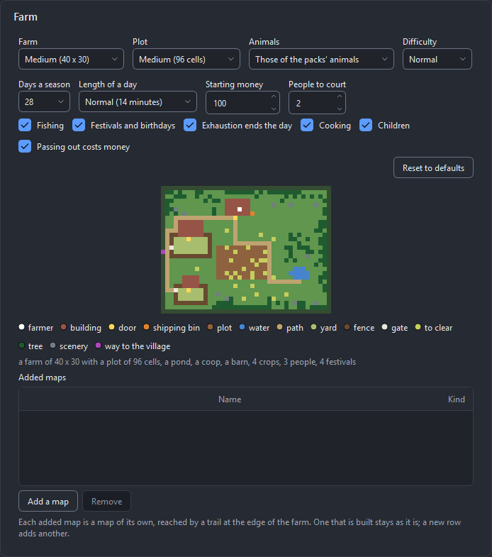

**Playing.**

| Action | Keyboard | Gamepad |
|--------|----------|---------|
| Walk | W A S D, arrow keys | D-pad, left stick |
| Use what you hold on the tile ahead | Space, J, left mouse button | A (cross) |
| Talk, read, open, sleep, the shipping bin | E | X (square) |
| Next / previous thing of the hotbar | R / Q | right / left shoulder |
| Hold slot 1 to 10 of the hotbar | 1 to 9, 0 | |
| Menu, pause | Escape, Tab | Start |

* **The tile ahead** is the square in front of you with the white frame: what you hold is
  used there. A tool works, a seed is planted in tilled soil, food is eaten, and a ripe crop
  is picked whatever you hold. The **hotbar** at the bottom is the first ten stacks of your
  bag.
* **A day** runs from 6:00 to 2:00 of the night. Time stands still in menus and while
  somebody talks. **Sleep** in your bed (interact with it; it does not ask) to end the day:
  the game is saved, and you wake at 6:00 with all your energy. Sleeping is how a farm saves.
  Still up at 2:00, you pass out: you wake at your bed with half your energy and a tenth of
  your money gone, and that is saved too.
* **Energy** is the yellow bar over the hotbar. A tool costs some when it does something. At
  zero you walk slowly and no tool works; eating what you harvested restores it.
* A new game starts with a **hoe**, a **watering can**, fifteen seeds of the first crop and
  the starting money. The **sickle**, the **axe** and the **fishing rod** are bought at the
  shop. The can holds water for 20 squares and is filled at the pond or the well.
* **Crops.** A seed goes into tilled soil, in a season the crop grows in. Every night a crop
  whose soil was watered that day grows by a day; one that was not waits. Some crops grow
  again after a harvest. When the season changes, a crop that does not grow in the new season
  withers.
* **Money.** Put what you want to sell into the **shipping bin** beside your house: it is
  sold overnight, and the morning begins with a list of what it earned. The **shop** in the
  village sells the seeds of the season and the tools, and buys at the price the bin pays; it
  is open from 9:00 to 17:00 and closed on Sunday.
* **People** have a day of their own: at home, at work, on the square, indoors when it rains.
  Talking to somebody once a day and giving gifts (hold the gift and interact; two a week)
  earns hearts, by what the person loves, likes and dislikes. *Pause → People* lists who you
  have met.
* **Animals** (with the option): bought at the shop while their house has a free stall, out
  in their yard by day and in their stalls from 18:00 and in bad weather. Put hay into the
  trough, pet them, and collect the egg from the floor of the coop or milk the cow by
  interacting with her; no pail is needed. Animals never die. A coop on a pack whose only
  animal is a cow stays empty, since a cow lives in the barn.
* **Fishing** (a farm with a pond): hold the rod, face the water and use it; after a bite,
  hold the button to keep the green zone over the fish until the meter is full. **Foraging**:
  every morning a few things of the season lie at the edges of the farm.
* **Weather.** A day is sunny or rainy, with storms in summer and snow in winter. Rain waters
  the whole field. The sign beside your door tells tomorrow's weather.
* **Festivals** (with the option, which is on): one a season, always a Friday (spring 12,
  summer 12, autumn 26 and winter 26 in seasons of 28 days). The shop is closed that day and
  everybody stands on the village square from 9:00 to 20:00. In spring five **eggs** lie in
  the village: find them with interact, each pays a little and the last one a prize. In
  summer the **fish** you land that day are counted (on a farm that cannot fish: the things
  your bin sold this season). In autumn the judges' **table** on the square judges the
  dearest thing your bin sold this season. In winter you bring a dish, any food, to the
  table, and the whole village likes you a little more. The day before, the sign by your
  door and the people say that it is coming.
* **Birthdays.** Everybody has one. The first gift you give somebody on that day counts five
  times and is not one of the week's two. *Pause → People* names the day of who you have met.
* **The calendar** hangs on the wall of your farmhouse (interact with it) and is in the pause
  menu as *Calendar*: the weeks of the season, today, the festival and the birthdays.
* **Marriage** (with *People to court* above 0). Somebody you can court stops at eight hearts
  until you give them a **bouquet** from the shop; at ten hearts a **pendant** is a yes, and
  the wedding is three days later, a day on the square for everybody. The spouse then lives in
  your farmhouse, has a day of their own (home in the morning, the square on two afternoons a
  week), says other things, and on some mornings waters part of the plot, feeds the animals or
  leaves something on the table for you. Friendship you neglect falls slowly (2 points a day
  without a talk); nothing worse happens. The farmhouse has a bed for two; one built before
  marriage keeps its bed, and the spouse lives there all the same.

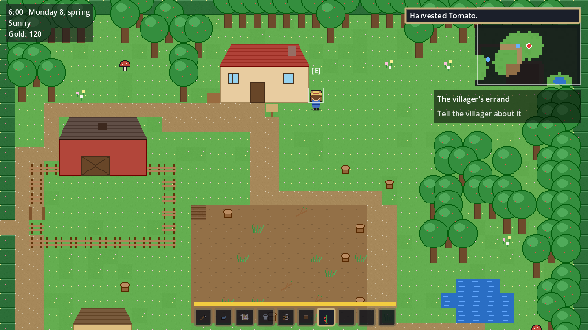

**What is yours.** The game reads five lists that rpggen writes once and then leaves alone:
`game/data/crops.json` (a crop's seasons, days, regrowth and items), `game/data/people.json`
(homes, jobs, schedules, tastes, birthdays), `game/data/animals.json`, `game/data/forage.json`
(fish and things to forage) and `game/data/events.json` (the festivals: their days, where the
eggs lie and the table stands, the prizes; removed like a crop). A crop, an animal, a fish or a thing your packs gain later is added by
the game from rpggen's own list, so deleting an entry of those three files does not remove it:
write `{ "id": "berry", "removed": true }` in its place. (People are read from your file
alone: delete the entry.) The farm is `game/maps/farm.tscn` with the farmhouse and the animal
houses as rooms beside it, and the village is `game/maps/starter_map.tscn`; like every map
they are built once. A crop, an animal or a fish your packs gain later is added to the plan
and to the lists under `generated/data/`, and the game uses what your own lists do not have.
The project's `README.md` (section 22) explains every entry, the numbers behind friendship
and energy, and how to add a crop.

**Known limits.** Nobody has played a whole season by hand yet: the length of a day, the
prices and the energy are untuned. The door to an added map is a mark on the ground beside
the farm's edge, not a gap in it, and a tree that stands before it can hide it; the people of
the village never go to an added map. Nobody has fought in the cave by hand: the enemies,
the sword and the prices of the cave are untuned, the rock is drawn as flat dark shapes (on
diamonds too), and the farmer's own attack animation is played only when its sheet has one.
The farmer's tool strips of a pack are not played. A field has no edge tiles: tilled
soil is one tile of the pack's soil sheet. Nobody has played a festival by hand: the prizes
are untuned, the eggs and the table are drawn shapes that no pack's picture replaces, and you
can walk through the table. A farm that was generated before festivals has its calendar in
the pause menu only, its eggs lie round the square and not at places of their own, and its
people say nothing of the day (their dialogue files were written before). Nobody has courted
anybody by hand: the hearts the smoke run needs are given to it, and the help is untuned. The
spouse in the farmhouse is seen in the morning and the evening only; at night they are not
seen, and they never walk onto the farm itself. A person from a farm made before marriage has
no lines for courting in their dialogue (the spouse at home has its own). Children, cooking
and crafting are not part of this kind.

## 3d. The isometric view

Some packs are drawn at an angle: every tile is a **diamond**, and houses and trees stand on
it. rpggen makes four kinds of game in that view: the **turn-based RPG**, the **action RPG**,
the **farm** and the **racing game**. It is the same game with the same plan of its map; only
what you see, and where things are on the screen, is different. The metroidvania, the shoot
'em up and the run and gun have no isometric view.

**Trying it.** **Choose a sample** on the welcome view lists *Stone isle*: a small isometric
pack (grass and stone ground, water with shore pieces, a path and walls in pieces that name
their sides, a house on four diamonds, a block, trees, a hero, two villagers, a slime and a
chest) that is generated as a turn-based RPG in the isometric view. With it the list has
seven samples.

**What an isometric pack looks like to rpggen.**

* **One picture a tile.** The pack is a folder of single pictures, all of one size (or of one
  width), each with see-through corners and the tile resting at the bottom: not a sheet cut on
  a grid. rpggen takes it for isometric when its name or a text file says so, or when the
  measured tiles agree.
* **The diamond** (the footprint a tile stands on) is read from the pack's own text file when
  it has one (`Tile information.txt`, `Tiled (settings).txt`: the *Map tile size* wins), and
  measured from the flat tiles otherwise. It is never assumed to be twice as wide as high.
  The pack's card says *Isometric tiles, 40 x 22*. A pack that says it is isometric and has no
  flat tile to measure gets TILE-010, and its pictures stay pictures.
* **Sheets named by their cell** (Screaming Brain's packs: `Floor_Dry_01-256x128.png`, a sheet
  of diamonds on magenta; `Flat_Brick_01-SE-128x192.png`, a sheet of wall faces) are cut cell
  by cell, the background made see-through, the cell taken from the name or from the Tiled
  tile set beside the sheet. A cell twice as wide as high is the pack's diamond. Two wall
  faces side by side, one slanting each way, are one wall in four pieces, one for each side of
  a diamond: the builder lays the edge of a map and a house from them. *Doorway* and *Window*
  in a name mark the pieces with a door and with a window. A *Small* and a *Large* copy are one
  pack in two sizes: the smallest is used unless you choose the other on the Packs tab. A
  piece of another shape (Screaming Brain's thick walls and corners) stays unread, with the
  reason. TILE-014 says when a pack's flat tiles measure another diamond than its names give.
* **A large ground picture** (*Lords Of Pain*'s `ground_stone1.png`, 256 x 256) in a pack that
  says it is isometric and gives no diamond otherwise is cut on a diamond of the classic 2 : 1
  angle when it tiles: as wide as the picture, halved while the pack's own characters still
  fit (a figure of 100 px stands on diamonds of 128 x 64). A picture of one colour all over is
  no ground. The other pictures of such a pack (its props) stand on that diamond.
* **Turns.** Names that differ only in a last `_0` to `_3` (or `_7`), or in a last compass
  word (`_N`, `_E`, `_S`, `_W`), are one thing turned, not the frames of an animation: one
  card in the audit with a **Turns (4)** row. Of a car or a boat they are its headings.
* **Sides in a name.** `pathES.png`, `waterNW.png`, `wallEW.png`: the capitals say on which of
  the diamond's four sides the piece joins. rpggen lays roads, shores and walls with the piece
  that fits the neighbours of each cell, as terrains join for a top-down pack; where a pack
  has no piece for a case the nearest is used and the report says so.
* **Terrains on diamonds** (from release 1.5). Pieces that join along the sides of a diamond
  are a terrain of the isometric TileSet, read from the pictures (on which sides the surface
  of a piece goes on, and whether the pixels along the sides of two pieces meet) and from the
  names: a name gives the sides a road goes on (`roadES`) or the sides the land is on
  (`waterE`, `beachCornerNE`), and the pictures say which. Screaming Brain's *Pathways* and
  *Roads* (eleven pieces in a sheet, without names) are each a terrain of paths laid over the
  ground; Kenney's road, river and shore pieces are terrains of roads and of water. Roads,
  paths, a race track and ponds are then painted with Godot's terrains.
* **Walls along a side.** Many packs draw a wall as a thin piece that stands along **one side**
  of its diamond, in four turns (and a wall with a door, a wall with a window, a fence, the
  same way). rpggen measures which side each picture stands along (the audit shows it as the
  facet `edge`) and lays the edge of a map from the pieces of one wall, each on the side that
  looks out of the map, with the way out left open. It takes the lowest plain wall of your
  packs, so that nobody is hidden behind it, and for a farm the fence; where two sides of the
  edge meet, at the map's corners, it puts a post of the wall's colour, no higher than the wall, when your packs have
  posts. Screaming Brain's thick walls (a face with the wall's end beside it) and its corner
  pieces are read as walls and posts. A pack with whole wall
  tiles is laid with those, as before.
* **A house of pieces.** When no pack drew a whole house for this view and your packs have a
  wall for all four sides and a wall with a door, rpggen **puts a house together**: walls
  along the sides of its footprint, the door at the plan's door, windows on some of the other
  places, a **post at each corner** where two walls meet when the packs have posts (a pole, a
  corner piece: the one of the colour of the walls), and **one roof**: when the packs draw a
  roof as slopes and the quarters of a hipped roof (*Miniature Farm*'s `roof` and
  `roofCorner`), the slopes rise from every side to a ridge with hips at its ends; when their
  slopes cover only half a cell and they have a gable over one cell (*Medieval Town*'s
  `roof_straight`), every row of the house gets one gable along its length; only a pack with
  neither gets a roof tile over every cell. It blocks its footprint and is walked into like
  any house. The Mapping page has no *Building* to choose then, and
  nothing is missing. A pack with a whole house gets that house, as before.
* **Round road corners.** A road piece that joins two neighbouring sides is read as *round* (it
  turns in a quarter circle) or *square* (the road fills the corner): the facet `corner`.
* **Objects.** A picture whose base is narrower than the diamond (a tree, a sign) stands on
  one; a house may stand on several.
* **What is set aside**: a folder `Angle` beside `Isometric` (the same models in another
  view), a sprite sheet with a `<TextureAtlas>` file beside the same loose pictures, previews
  and samples. A pack that is a zip inside its folder is opened.
* **People.** Most isometric packs have no characters. A hero, a villager or an enemy from
  another pack of the project is used as it is, **seen from the front**, which is the usual
  look of such games; when no pack has them, rpggen draws a hero, a villager and an enemy
  (ASSET-031).

**Choosing it.** On the Archetype page rpggen says *This pack is isometric (40 x 22 diamonds).
The view is chosen on the Options page.* There, the box of each kind that has the view (the
*Starter map*, the *Farm* box, the *Tracks* of a race) has a **View** choice **when one of your
packs has isometric pictures**. With packs of square tiles alone there is nothing to choose,
and the row is not shown.

* *From above* or *Isometric*. For a new project rpggen chooses *Isometric* when your packs
  have isometric ground and no ground of square tiles, and *From above* otherwise.
* **Isometric needs isometric ground tiles.** No ground is drawn for this view: when your
  packs have isometric pictures but none of them is a ground tile, the choice stays *From
  above* and the line under it says so: *These packs have isometric pictures but no isometric
  ground tile to build a map on. Give one the role Ground on the Audit page.* (On the command
  line it is CAT-002.) One project has one ground: isometric and square ground tiles mapped in the same
  project are TILE-011, and tiles of a pack whose diamond is another size are left out
  (TILE-012).
* **The view is fixed once the project has been generated**: its maps are painted in it.
* **Pad** (shown with *Isometric*, for the games you walk in): *follows the screen* (up is up;
  the default) or *follows the diamonds* (the four directions go along the edges of the
  tiles). A race has no *Pad*: it is steered, and its *Steering* option says how. A config
  file of a race that carries `"iso_controls"` is accepted, and the key is not read.

An isometric project is offered, on the Mapping page, only what fits its view: isometric tiles
and objects, and characters, items and sounds of any pack; a project seen from above is
offered nothing isometric.

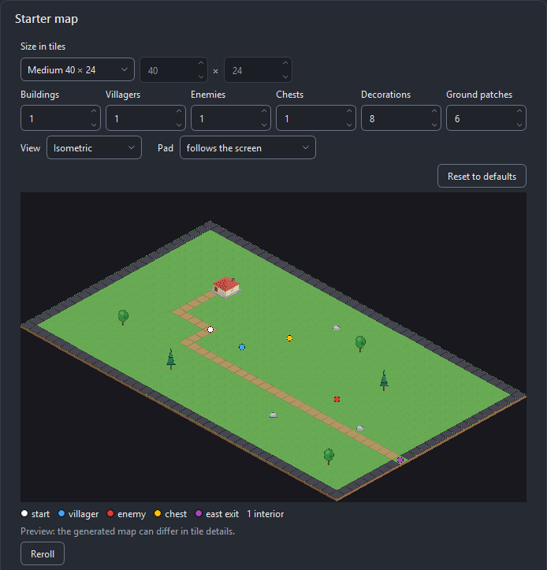

The picture beside the options is the planned map on the pack's diamonds. The picture of a
**farm** is drawn on diamonds too; the tracks of an isometric **race** are still shown from
above.

**In the audit.** *Edit grid…* on a picture of an isometric pack draws its diamond over it.
For a tile you can change the **Diamond w / h** (every tile of a project stands on the same
one); for an object, how many diamonds it **Stands on** (columns and rows: it blocks them, and
a building has its door before the middle of its front).

**What the game looks like.**

* The map is the one the same options would plan from above: the same size, house, path,
  villagers, chest and exits, laid on diamonds. The camera is drawn back when the diamonds are
  large, to a zoom at which a step from one diamond to the next is a whole number of pixels
  (0.5 on diamonds of 180 x 104): at other zooms thin dark dashes showed along the edges of
  the tiles. The minimap stays the plan from above.
* You are drawn behind what stands nearer to the bottom of the screen and in front of what
  stands further up; a house of several diamonds is cut in two halves for that.
* A raised block that has the role *Ground* does not block: height is not modelled.
* A **farm** is the same farm: the tile ahead is the diamond you face (watch the white
  frame), and what your packs did not draw for this view (buildings, fences, the well, trees)
  is a box on its diamond. With walls and a door as pieces the farmhouse, the coop and the
  barn are put together from them, and with a fence that stands along a side the farm's edge
  and its yards are fenced with it. The project's `README.md` has the details.
* A **race** is driven exactly as from above and only drawn at an angle. When the road pieces
  of your packs have **round corners**, the track is planned with round corners, so that the
  road you drive on is the road you see: the outside of a corner is grass, in the picture and
  under the wheels. (A track that was generated before keeps its corners.) A car drawn for this
  view has its headings as separate pictures (`car_N.png`, `car_NE.png`, …) and turns in
  steps; a car drawn from straight above is used too and **looks flat**, which the Mapping
  page says beside it. No isometric car is drawn for a pack without one.

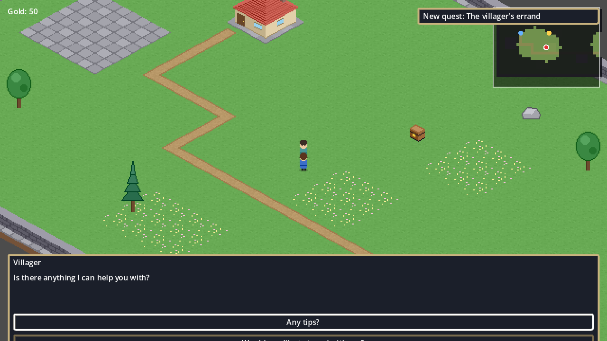

**An isometric Tiled map.** A pack that ships a Tiled map whose orientation is *isometric*
(Kenney's *Isometric Miniature* packs have one in `Samples/Tiled Sample.zip`) lists it in the
*Imported maps* box like any other map, and an isometric project builds it on its diamonds:

* Each tile is the picture its Tiled tile shows. The pictures are read as the pack's own are,
  also when they lie in a folder of samples, and they join the project's tile set for that map
  alone: they stay *unused* in the audit and fill no role. A picture whose file is not read as
  isometric is matched by its bytes to one of the pack's isometric pictures.
* The first layer that Tiled draws in its place is the ground; every other layer stands among
  the people and things of the map, so that you walk behind a wall and in front of it, and a
  layer that Tiled draws higher (a second floor) is drawn as high. A tile flipped in Tiled is
  drawn unflipped.
* A picture whose role is *Wall*, or (for a picture of the samples) whose name says wall, blocks
  its diamond. Nothing else of the map blocks.
* Objects named `spawn`, `door` or `sign` stand on the middle of their diamond. Without a spawn
  you start on the free ground nearest the middle of the map's ground.

A map of squares is not built into an isometric project, nor an isometric map into a project
seen from above: the run says *The map … is drawn on diamonds and this project is seen from
above: it is not imported.* (TILE-013), and a starter map of the other view is planned as if
none was chosen. Staggered and hexagonal maps are not read.

**Known limits.** Nobody has played an isometric game by hand yet. The **RPG Project Tools**
dock places on diamonds (see *4. In Godot*), but nobody has dropped anything into an isometric
map with a mouse yet: it was run by a test in an editor without a window. An imported
isometric map has no height: the stairs of a sample are pictures you walk across, and a second
floor is only drawn higher. A room has walls only when the packs have isometric wall pieces.
The isometric terrains are roads, paths and water: a ground that changes from grass to sand
on diamonds, cliffs and walls are not painted with terrains. A house of pieces has one storey. On
*Medieval Town* its roof is a gable a row (two side by side on a house two cells deep): the
pack's slopes and hips cover half a cell and carry walls of their own, and are not used. Screaming
Brain's *Town* roofs are whole roofs of one cell: a house of several cells gets one a cell. A
track is planned with round corners only when the piece of every
one of its four corners is round.

### The farm and the isometric view from the command line

`rpggen generate --archetype farm` makes a farm, and `--projection isometric` (with
`turn_based`, `arpg`, `farm` or `racing`) the isometric view of a pack that has isometric
ground; a config file carries both itself (`"archetype"`, `"projection"`, `"iso_controls"`).
`--dry-run` says what would be planned, for a farm for example *village: 40 x 24 tiles* and
*farm: a farm of 40 x 30 with a plot of 96 cells, a pond, 4 crops, 3 people*. See [Running
rpggen from a script](#7a-running-rpggen-from-a-script).

## 4. In Godot

The game's *Settings* have a **Language** choice: *System* and every language of the project's
`game/i18n/strings.tsv` (add a column with a locale code to translate the game; the project's
README explains how).

**Light.** Each map has an ambient light: daylight outdoors, dimmer indoors. Objects whose name
says they give light (torch, lamp, lantern, candle, campfire) get the `light` tag in the audit,
and their scenes a light, a flickering one for a flame. You can add or remove the tag on any
object. *Settings → Day and night* (off by default) lets the outdoor light follow a day of 24
minutes of play.

**Minimap and world map.** A small map in the top-right corner shows the area around the player:
a dot for the player, marks for doors, chests not yet opened and what the current quest stage
points at, and darkness over the cells not seen yet. *Settings → Minimap* turns it off. *Pause →
Map* shows every map visited so far, the unseen parts covered; what has been seen is kept in the
save. A game with a world of several areas lists **World** first: every area where it lies,
the ones you have been to lit, with the doors between them. The pictures are made by the build from each map's tiles, so a map you repaint gets a new
one on the next regeneration.

**What the game can do, and where to change it.** The project's `README.md` has a section for
each part you are likely to edit: dialogue (and the dock's Dialogue tab), items, **equipment and
shops**, **quests** and the journal, cutscenes, keys, switches and gates, languages, credits,
sound, light, the minimap, your own build steps, and the combat of your archetype (turn-based:
the **party**, **random encounters**, skills, MP, elements and statuses, enemy tactics; action
RPG: enemy kinds such as shooters, turrets and chargers, bows, and the heavy attack).

Key prompts follow the player's device: `[E]` on the keyboard, the pad's own button name
(`[A]`, `[Cross]`, `[B]`) once a controller is used, and a remapped key at once.

The project has a `README.md` with the controls and where things are: the sound slots and how to
change them, the heavy attack of the action game, autosave and the game-over screen, and how the
maps (the starter map, a house interior per house, and the field or the areas of your world) are
connected. Your own work goes in
`game/`; rpggen never overwrites it. The **RPG Project Tools** dock lists every object, building and
character from your packs: drag one into the map (it lands on the right layer, snapped, Y-sorted),
edit an asset's role or collision in the inspector and *Rebuild*, validate the content (duplicate
entity ids, broken doors, missing sprites) and remove the demo content when you start your game.
Its **Dialogue** tab edits the conversations in `game/data/dialogue/` line by line: speaker,
portrait (from your PORTRAIT assets), text with a preview of its formatting, the condition, the
events, the choices and where the line goes next, with undo (Ctrl+Z). A condition or an event
the game would not understand is marked at once, and **Test** plays the conversation against a
pretend game state whose flags and items you tick, without touching your saves. Dialogue can be
exported to and imported from JSON. An event that names a shop, a quest or a character that does
not exist is marked too, and the validator reports it (VAL-019).

The **Quests** tab edits the quests in `game/data/quests/`: the list of stages, and for each its
id, title, description, the condition that finishes it (checked as you type), the stage it leads
to, the entity the minimap points at (pick it from the map that is open) and its rewards. A
picture beside the form shows the stages and how they follow each other, and **Test** tells you
which stage the quest reaches with the flags, items and gold you set. The **Cutscenes** tab edits
the sequences in `game/data/sequences/` step by step: move, face, say, wait, camera, flag, give,
play sound and fade each have a form (every other command can be edited as JSON), a step that
names a character the open map does not have is marked, and **Test** plays the cutscene in the
game when you have started it from the editor. Both tabs undo with Ctrl+Z and export and import
JSON.

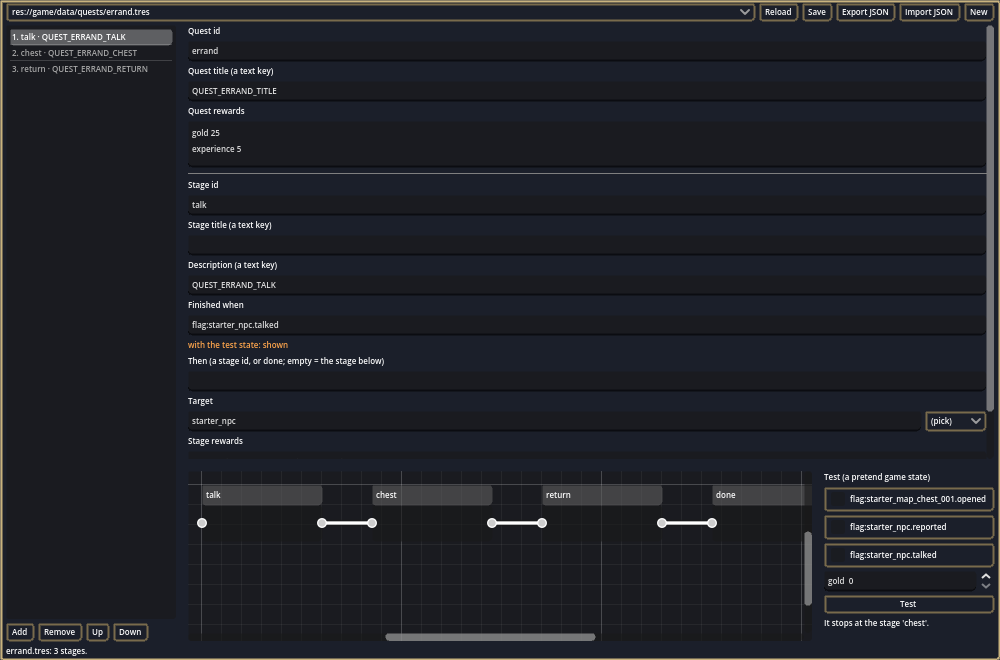

On the dock's **Validate** tab, **Fix** and **Fix all** mend doors that lead nowhere and maps that
cannot be reached (they add the missing spawn point or door; Ctrl+Z takes it back).

**On an isometric map** the dock counts diamonds. What you drag in or double-click stands on the
middle of the diamond under the mouse, where the generator puts its own trees and people, and it
goes among the Y-sorted entities, so it is drawn behind and in front of what is there. A house
of several diamonds stands with its nearest corner on that diamond and covers the diamonds
behind it. The status line says which diamond it was. Three things differ from a map of squares:

* While you drag, the picture follows the mouse freely; it settles on its diamond when you let
  go.
* Every **Snap** choice but *Off* means *the diamond*: a grid of 8 or 32 pixels has no meaning
  there. With *Off* the object stays exactly where you dropped it.
* Nothing is dropped to a floor: that is for the rooms of a metroidvania, which are never
  isometric.

As on squares, the dock does not refuse a diamond that is taken or that lies outside the painted
map: look where you drop. A trigger area, a gate and a door added by **Fix** have the shape of
their diamond; a floor switch and a lever keep their small square; an encounter zone added with
nothing selected covers six by six diamonds. Ctrl+Z takes each back, as on squares.

**Shops.** In a shop, left and right choose how many to buy or sell (up to what you can pay for,
carry or own), and **Sell all** sells everything the shop buys after a second press.

Your own build steps go in `game/builder_recipes/`: GDScript files that run after rpggen's
steps on every build ([custom recipes](recipes.md)).

## 5. Regenerating

Change options, fix the audit, or add a new release of a pack, then run rpggen on the same output
folder. Your maps, scenes and everything under `game/` are kept. Read [regeneration](regeneration.md).

**Maps painted with terrains** (from release 1.5). A new map is painted with the terrains of
its TileSet: the ground with the variants of its tile, patches of another ground, roads and
paths, ponds and the sea with their shores, and a farm's field with its edge where it meets
the grass (tilled and watered soil join the soil round them as you hoe). A map that exists
under `game/maps/` is never painted again: a project made before 1.5 keeps the maps it has,
and the run says which with **TILE-015**. To have one painted anew, move it out of the folder
and generate again (what you changed on it by hand is then lost). The variants are chosen by
the project's seed: the same project paints the same maps on every run.

Before anything is written, rpggen lists what the run will change: the files it updates, the
generated files you changed (their new version is written beside them as `.rpggen-new`), the
files it no longer makes, the files you deleted (they stay deleted) and where the backup goes.
**Cancel** leaves the project exactly as it was. *Edit → Show changes before regenerating* turns
the list off.

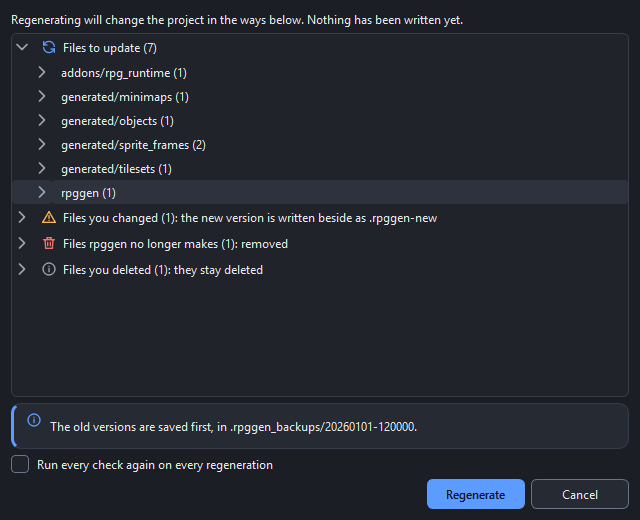

## 6. Troubleshooting

Every message has a code; [errors.md](errors.md) lists all of them with the fix. The common ones:

| Code | Meaning | What to do |
|------|---------|------------|
| ENV-001 / ENV-002 | Godot not found or not 4.7.x | Select the Godot 4.7.2 executable on the project page. |
| ENV-003 | A different 4.7.x build than the validated 4.7.2 | Works, but use 4.7.2 for guaranteed results. |
| ENV-005 | Not enough disk space | Free space or pick another drive (3× the pack size is needed). |
| ENV-006 | Output in a cloud-sync folder | Pick a local folder. |
| ENV-007 | Paths may exceed 260 characters | Use a shorter output folder or enable Windows long paths. |
| ENV-009 | The output folder is not empty | Pick an empty folder or an existing rpggen project. |
| ENV-010 | Export templates missing | Info only: install them from Godot (Editor → Manage Export Templates) to enable the export check for that platform. |
| ASSET-010 | A required role has no asset | Assign one on the Mapping page or use a placeholder. |
| ASSET-031 | Something the kind of game needs was drawn for your pack | Info only: the game plays; give an asset of your own the role to replace the drawing. |
| CAT-002 with `/projection` | The isometric view was asked for and the packs have no isometric ground tile, or a generated project was asked for another view | Add a pack of isometric tiles, or leave the view as it is. |
| TILE-010 / TILE-011 / TILE-012 | An isometric pack's diamond could not be read / isometric and square ground in one project / tiles on another diamond were left out | The pack's pictures stay plain pictures (a text file of the pack that gives the tile size of its map is read when there is one); leave one of the two grounds out; use packs drawn on one diamond. See [The isometric view](#3d-the-isometric-view). |
| TILE-013 | A checked imported map is drawn in the other view than the project's (diamonds against squares) | It is not built. Uncheck it, or make a project of the map's view. See [The isometric view](#3d-the-isometric-view). |
| VAL-031 | A farm's plan cannot be worked (the plot, the bed or the bin cannot be reached) | Mend the farm's map in `rpggen/world_plan.json` (the section `farm.map`), or delete that section and `game/maps/farm.tscn` and regenerate to have the farm planned again. |
| ASSET-001 / ASSET-003 | Tile size uncertain / grid does not divide | Fix the grid in the audit. |
| REGEN-005 | The Godot editor has the project open | Close it, press Retry. |
| REGEN-006 | A new major runtime version | Confirm the upgrade (`--accept-runtime-upgrade` on the CLI). |
| BUILD-00x / VAL-0xx / SMOKE-00x | A recipe, validation or smoke step failed | View the logs, export a diagnostic bundle. |
| GUI-001 | An unexpected error in rpggen | Export a diagnostic bundle and report it. |

The **Help → Error codes…** dialog looks a code up and shows what to do. Light theme:

## 7. Diagnostic bundles

If something goes wrong that you cannot fix, send a diagnostic bundle with your bug report:

* In the wizard: **Export diagnostic bundle** on the Results page or in the error dialog.
* On the command line: `rpggen-cli diagnose --target <project or .rpggen_failed folder>`.

The zip has your configuration and catalog, the ownership ledger, build results, the logs (with
your user name and home folder replaced by `<user>` and `<home>`, each cut to its last 5 MB), a
manifest of every asset (id, path, hash, size) and system information. **It never contains images
or audio.** Open it before you send it if you like.

## 7a. Running rpggen from a script

Everything the wizard does for a finished config is also a command (`rpggen-cli`, see the README).
Four options are meant for scripts and build servers:

* `--dry-run` (on `generate`) checks the packs, the output folder and the requirements and plans
  the starter map without writing anything or starting Godot. Use it to find out, before a long
  run, that a role has no asset or that the folder belongs to something else.
* `--confirm` (on `generate`) prints what a regeneration is about to change (files to update,
  your changed files that get a `.rpggen-new` copy, deletions) and asks y/N on a terminal. Without
  a terminal the answer is no and the run is cancelled (exit code 4). In the wizard the same list
  is shown in a dialog before a regeneration writes anything (Edit > Show changes before
  regenerating, on by default).
* `--json` prints one JSON document on stdout; the readable lines go to stderr.
* `--tile-size N` (on `generate --pack`) sets the base tile size, 8 to 256 px. Without it rpggen
  uses the size most of the pack's tile sheets have; a config file carries its own.
* `conflicts --target <project>` lists the files that have a `.rpggen-new` version; add a file and
  `--keep-mine`, `--take-new` or `--merge` to resolve it, as the wizard's *Resolve conflicts…*
  does.
* The **exit code** says why a command stopped: 0 OK, 1 generation failed, 2 usage error,
  3 environment or input (Godot or a pack not found, an unusable folder, a required role with no
  asset), 4 cancelled with Ctrl+C (nothing is delivered), 70 internal error (send a diagnostic
  bundle).

## 8. Privacy and the network

rpggen does not phone home. It goes online in exactly three cases, and only after you click:

1. **Find profile online** (Audit page, Profile menu): downloads the community profile index
   and the profile you pick from this project's `registry/` folder on GitHub.
2. **Download Godot** (Project page, or the welcome view): downloads the official Godot 4.7.2
   from github.com/godotengine/godot/releases after you confirm the source, size and
   destination, verifies its SHA-512 checksum and keeps it in rpggen's own folder. Your other
   Godot versions are not touched.
3. **Help > Check for updates**: asks GitHub for the latest release of this project and offers
   to open its download page in your browser. rpggen never downloads or installs an update.

There is no start-up check, no background timer and no setting that enables one.

**Learned rules stay on your computer.** When you fix the role, usage or collision of assets in
the audit, rpggen keeps what it learned (*"files in a folder named `trees` are decorations"*) in
`learned_rules.json` in its data folder (see below), to suggest the same for your next packs. The
file holds folder and file-name words, the values you chose and how often; it is never uploaded
and never put in a project. **Edit → Learned rules…** lists the rules, turns them off, deletes
them or makes them folder rules of the open project; deleting the file forgets everything.

## 9. Where rpggen keeps its files

rpggen keeps what it needs in three folders, so that a disk-cleanup tool (which empties folders
called "cache") cannot take your work with it. **Edit → Storage…** shows how big each part is and
clears it.

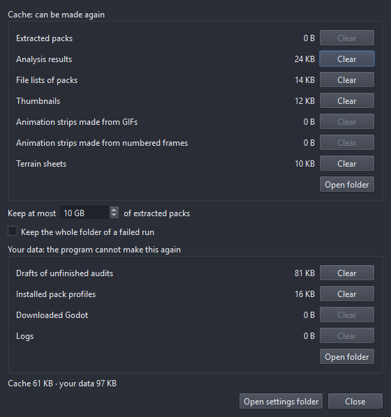

| Folder | What is in it | Windows | Linux | macOS |
|--------|---------------|---------|-------|-------|
| Settings | `settings.json`: window, theme, recent projects, option presets | `%LOCALAPPDATA%\rpggen\config` | `~/.config/rpggen` | `~/Library/Application Support/rpggen` |
| Your data | drafts of audits you have not generated yet, installed pack profiles, the rules learned from your fixes (`learned_rules.json`), the Godot rpggen downloaded, the logs | `%LOCALAPPDATA%\rpggen\data` | `~/.local/share/rpggen` | `~/Library/Application Support/rpggen` |
| Cache | extracted archives, analysis results, file lists, thumbnails, GIF and frame strips, terrain sheets | `%LOCALAPPDATA%\rpggen\cache` | `~/.cache/rpggen` | `~/Library/Caches/rpggen` |

(On Linux the `XDG_CONFIG_HOME`, `XDG_DATA_HOME` and `XDG_CACHE_HOME` variables are honoured.)

* **The cache can always be made again**, so it is kept small: extracted packs beyond the limit
  in **Storage…** (10 GB by default) are removed, the least recently used first and never the one
  you are working with; analysis results, file lists and thumbnails together stay under 1 GB.
* **Your data is only deleted by you.** Clearing it in **Storage…** first lists what you lose. A
  half-downloaded Godot that was not resumed for a week is the only thing removed by itself.
* A version before 1.0 kept everything in one folder; the first start moves the settings, drafts,
  profiles, Godot and logs to their new places and never overwrites what is already there.
* Your **generated projects** are never in these folders: they are where you chose to put them.
